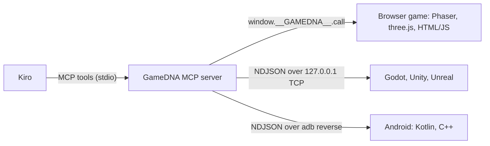

# Design: GameDNA for every engine (v0.2)

Requirements: `requirements.md`. v0.1 design: `../gamedna-mvp/design.md`.

## 1. Shape

GameDNA keeps one brain in TypeScript and adds one thin adapter per engine. The brain covers scenarios, assertions, metrics, experiments, decisions and reports. The adapter only drives the game's simulation and answers requests.



Only three v0.1 parts were Phaser-specific. Each is replaced by an engine-neutral part:

| v0.1 part | v0.2 replacement | Lives in |
|---|---|---|
| `detectEngine` (Phaser or error) | Engine profile table | `packages/mcp/src/engines.ts` |
| In-page `ScenarioExecution` in the Phaser bridge | Protocol v1 plus a TypeScript reference loop | `packages/core/src/bridge.ts` |
| npm-script-only command runner | Declared argument lists checked against engine tools | `packages/mcp/src/commands.ts` |

## 2. Engine profiles

`ENGINES` in `engines.ts` is the only list of engines. Detection, adapter install, asset folders, allowed tools and the verified flag all come from it. The engines are checked in the order below, and the first match wins.

| id | Detected by | Runtime | Adapter goes to | Default asset folder | Allowed tools |
|---|---|---|---|---|---|
| `unreal` | `*.uproject` | process | `Plugins/GameDNA/` | `Content/GameDNA/Generated` | `unreal-editor` |
| `unity` | `ProjectSettings/ProjectVersion.txt` | process | `Assets/GameDNA/` | `Assets/GameDNA/Generated` | `unity` |
| `godot` | `project.godot` | process | `addons/gamedna/` | `assets/generated` | `godot` |
| `android-cpp` | Android app plus `externalNativeBuild` or `src/main/cpp` | android | `app/src/main/cpp/gamedna/` | `app/src/main/assets/generated` | `gradlew`, `adb` |
| `android-kotlin` | Android app (`com.android.application`) | android | `app/src/debug/java/dev/gamedna/` | `app/src/main/assets/generated` | `gradlew`, `adb` |
| `phaser` | `phaser` dependency | browser | `@gamedna/phaser-adapter` | `public/assets/generated` | `npm` |
| `three` | `three` dependency | browser | `src/dev/gamedna-bridge.js` | `public/assets/generated` | `npm` |
| `web` | `index.html` with no engine above | browser | `gamedna-bridge.js` | `assets/generated` | `npm` |
| `custom` | `engine.id: "custom"` in the record | declared | none: the game implements the protocol | declared | the record's `engine.tools` |

iOS and macOS are out of scope. A folder with an `*.xcodeproj` or `*.xcworkspace` and no engine above gets `UNSUPPORTED_ENGINE`.

## 3. Bridge protocol v1

### 3.1 Transports

**Native and Android.** The MCP server listens on `127.0.0.1` on a free port, and the adapter connects to it. Each message is one UTF-8 JSON object on one line, at most 16 MiB. The adapter finds the address and token in two places:

- Desktop: the `GAMEDNA_BRIDGE=127.0.0.1:<port>` and `GAMEDNA_TOKEN=<hex>` environment variables.
- Android: the `debug.gamedna.bridge` and `debug.gamedna.token` system properties. `adb reverse` maps the device port to the host.

**Browser.** The page sets `window.__GAMEDNA__ = { protocol: 1, hello, call(method, params) }`. `call` returns the result or a Promise of it, and it throws an `Error` with a `code` property on failure. The server calls it through Playwright, and the URL carries `?gamedna=1`.

### 3.2 Messages

1. The adapter sends `hello` first:
   `{"type":"hello","protocol":1,"token":"…","engine":"godot","engineVersion":"4.7.2","game":"Mini","tickRateHz":60,"capabilities":["screenshot"]}`
2. The server checks the token and closes the socket if it is wrong. Otherwise it replies `{"type":"welcome","sessionId":"ses-…"}`.
3. The server then sends one request at a time and waits for its reply:
   - Request: `{"id":7,"method":"advance","params":{…}}`
   - Reply: `{"id":7,"result":{…}}` or `{"id":7,"error":{"code":"UNSUPPORTED","message":"…"}}`

The adapter never sends anything else, which keeps it passive. Adapter error codes are `BAD_REQUEST`, `UNKNOWN_METHOD`, `UNSUPPORTED` and `GAME_ERROR`. The server reports each one as `ADAPTER_ERROR` with the adapter's code in `details`.

### 3.3 Methods

| Method | Params | Result | Notes |
|---|---|---|---|
| `reset` | `seed`, `params`, `setup` | `tick`, `state` | Switches to controlled mode, resets the simulation, discards pending events, returns the snapshot. |
| `advance` | `to`, `inputs`, `sampleEvery`, `lastTick`, `maxEvents` | `tick`, `events`, `samples`, `truncated` | Runs the reference loop in 3.4. Controlled mode only. |
| `snapshot` | `fields?` | `tick`, `state` | Flat state of primitives. `fields` filters keys. |
| `events` | `cursor`, `limit` | `events` with `seq`, `nextCursor`, `dropped` | Ring buffer of the last 1,024 events, filled in both modes. |
| `parameters` | none | `values` | Current tuning values, including overrides. |
| `control` | `mode`: `live` or `controlled` | `mode` | `live` hands the game back to the player. |
| `screenshot` | none | `mime`, `data` (base64 PNG) | Only when `hello.capabilities` lists it. Otherwise `UNSUPPORTED`. |

### 3.4 Reference loop

`advanceHarness(harness, request)` in `packages/core/src/bridge.ts` defines what `advance` means. Every adapter ports these lines unchanged:

```text
while tick < to:
  for each input whose tick equals the current tick, in order: setInput(key, down)
  step()
  tick = currentTick()
  for each drained event: append {tick, type, data} unless maxEvents is reached (then truncated = true)
  if tick % sampleEvery == 0 or tick == lastTick: append {tick, state: snapshot()}
```

The server owns everything else: bounded sampling, checkpoints, assertions, `firstFailure`, repeats and metrics. One local scenario run and one remote scenario run share the same `ScenarioRecorder`, so a scenario file means the same thing on every engine.

### 3.5 Game-side harness

Each adapter wraps a harness that the game provides. The shape matches the v0.1 `GameHarness`, plus two members:

| Member | Purpose |
|---|---|
| `reset(seed, params, setup)` | Restart the simulation deterministically. |
| `setInput(key, down)` | Latch one action. Live input and scripted input use the same latch. |
| `step()` | Advance exactly one fixed tick. |
| `snapshot()` | Flat primitive state, e.g. `player.x`. |
| `drainEvents()` | Events since the last call. |
| `currentTick()` | Tick count since reset. |
| `parameters()` | Current tuning values. |
| `setLive(live)` | Pause or resume the game's own loop and player input. |

The wiring is one line in each engine:

| Engine | Line |
|---|---|
| Godot | `GameDNA.register(self)` |
| Unity | `GameDNABridge.Register(this)` |
| Unreal | `FGameDNABridge::Register(Harness)` |
| Android Kotlin | `GameDnaBridge.register(harness)` |
| Android C++ | `gamedna::Bridge::start(harness)` |
| Web | `installGameDNA(harness)` |

## 4. Commands and tools

A command in `.gamedna/project.json` holds exactly one of the following:

- `script`: an npm script name, as in v0.1.
- `argv`: an argument list whose first item is a tool name, not a path.

`{project}` in `argv` becomes the absolute project root. No other substitution happens.

| kind | Used by |
|---|---|
| `dev` | Browser session: the dev server at `url`. |
| `run` | Process or Android session: launch the game. |
| `headless` | `gd_run_scenario` without a session: launch, run, stop. |
| `install` | Android session: build and install before launch. |
| `build`, `test` | `gd_verify` project tests and builds. |

`resolveTool(name)` resolves a tool from the first source that has it:

1. `gd_configure_tool`, stored in the user config folder (`%APPDATA%/gamedna/tools.json` or `~/.config/gamedna/tools.json`), never in a repository.
2. An environment variable: `GODOT_BIN`, `UNITY_EDITOR`, `UNREAL_EDITOR`, `ANDROID_HOME` for `adb`.
3. The project's own `gradlew`.
4. `PATH`.
5. Known install folders: Unity Hub, Epic Games, the Android SDK.

A resolved path must have a basename that matches the tool's pattern. Shells and interpreters (`cmd`, `powershell`, `pwsh`, `bash`, `sh`, `python`, `node`) are refused whatever the record says.

`spawnCommand` never uses a shell. A `.cmd` or `.bat` file on Windows (npm, gradlew) runs as `cmd.exe /d /s /c` only after every argument matches `^[A-Za-z0-9_./:=@+,-]*$`. This also fixes v0.1's `spawn EINVAL` with `npm.cmd`.

## 5. Sessions

| Runtime | Start | Stop |
|---|---|---|
| browser | As in v0.1: the `dev` command, Playwright Chromium, `?gamedna=1`, wait for `__GAMEDNA__.protocol` | Close the browser. Kill the dev server only if this session started it. |
| process | Listen, start `run` (or `headless`) with the env vars, wait for `hello` | Close the socket, kill the process tree |
| android | Listen, `adb reverse`, `setprop`, optional `install`, `am start -S -n <package>/<activity>`, wait for `hello` | `am force-stop`, `adb reverse --remove`, clear the props |

All three produce one `BridgeClient` with `hello` and `call(method, params)`. `RemoteDriver` adds parsed, typed methods on top of it. Tools only ever see `RemoteDriver`.

## 6. What stays as it is

- Experiments, selections, decisions, revisions, reports, style packs and generators were already engine-neutral.
- Headless runs of a JavaScript harness module still go through the project's own Vite.
- The workbench embeds browser games. Native variants get a "Play" action that calls `reset` with the variant's parameters, then `control live` (phase 5).

## 7. Phases

| Phase | Scope | Verified by |
|---|---|---|
| 1 | Core protocol and reference loop; engine table; commands and tool resolution; process sessions; Godot adapter and fixture; `gd_install_adapter`, `gd_configure_tool` | Unit tests; Godot 4 headless conformance through MCP stdio |
| 2 | Web adapter; Phaser adapter moved onto protocol v1 (the in-page `ScenarioExecution` is deleted); three.js apps get the bridge | Existing MCP browser e2e, plus a plain HTML fixture |
| 3 | Android Kotlin and Android C++ adapters and fixtures; Android sessions | Emulator conformance (local, x86_64 image) |
| 4 | Unity and Unreal adapters and fixtures | Unverified until an editor is available |
| 5 | Workbench "Play" for native variants; engine skills and router targets; docs and PRD addendum; Godot in CI | Skills test, docs check, CI |

## 8. Alternatives considered

- **Per-engine drivers inside the MCP server** that call each engine's own test runner (GUT, Unity Test Framework, Unreal Automation, Android instrumentation) and parse its output. This was rejected. It copies assertion and metric logic into six result formats, and a scenario would mean something different on each engine.
- **Adapters that run whole scenarios**, the way the v0.1 Phaser bridge does. This was rejected. Every adapter would carry the assertion engine in its own language. Here, adapters port one small loop, and the conformance test proves the port.
- **The game listens and the server connects.** This was rejected. Android would need `adb forward` plus port discovery, and attaching to an editor would need a fixed port. Because the server listens, one connection flow works for every runtime.
