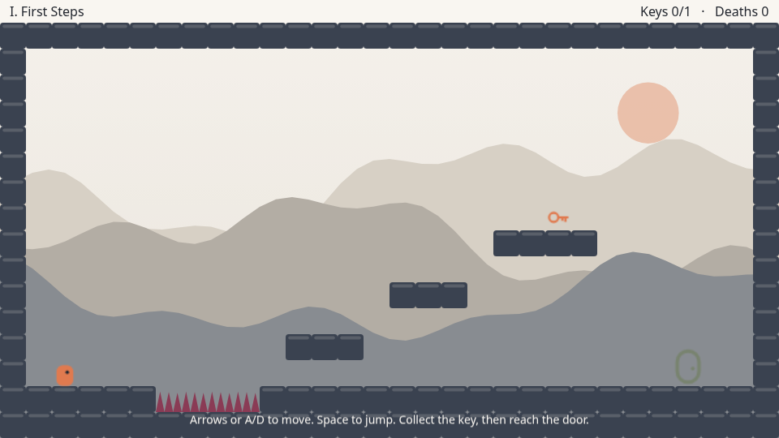
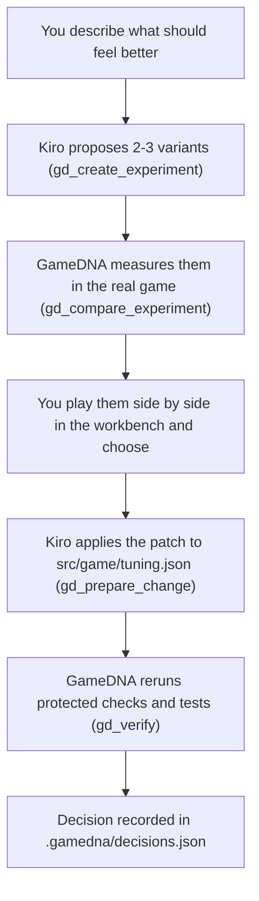

# GameDNA

[](https://github.com/bala2006/game-dna/actions/workflows/ci.yml)

GameDNA turns Kiro into a specialist game developer for Phaser games. It is a Kiro Power with a local MCP server that gives Kiro game-design skills, procedural art and sound, the ability to watch and replay a running game, and playable A/B/C experiments where **you** choose the result. Kiro then applies your choice to normal game source and verifies that the game's protected rules still hold.

Built for **Kiroween 2026** (Skeleton Crew category) on two reusable foundations:

- `packages/starter`, the lean 2D skeleton behind two Phaser games, `apps/gravity-shift` and `apps/neon-survivor`.
- `packages/kit`, the **GameDNA Kit**: tested code for 3D browser games (input on every device, camera views, cars and people at real proportions, terrain and roads, a lit three.js stage, a fixed-step loop). Two different three.js games, `apps/ridgeline-racer` and `apps/trail-walk`, are built only on it. See [packages/kit/README.md](packages/kit/README.md).



## The refinement loop




## What is in the box

| Path | What it is |
|---|---|
| `power/` | The Kiro Power: `plugin.json`, `mcp.json`, 20 skills (`gamedna-mode`, the entry point that routes each step to one skill, plus game direction, art direction, world building, level design, character design, vehicle design, controls and input, camera, motion and physics, game feel, game mechanics, feedback and UI, light and color, pacing and guidance, polish and detail, technical art, three.js, playtesting and refinement) the bundled server, and `kit/`, a copy of the GameDNA Kit source for games outside this repository |
| `packages/mcp` | 15 MCP tools: project status, style packs, design validation, asset generation, sessions, observation, scenarios, experiments, selection, change preparation, verification, reports |
| `packages/core` | Schemas, deterministic scenario runner, assertions, trace comparison, metrics, experiments and decisions |
| `packages/assets` | Three style packs and seeded generators for sprites, tiles, backgrounds, icons, particles and sound effects |
| `packages/phaser-adapter` | Development-only bridge (`window.__GAMEDNA__`), never in production builds |
| `packages/starter` | The shared lean 2D game skeleton: fixed-step simulation base and Phaser scene glue |
| `packages/kit` | The GameDNA Kit for 3D games: `random`, `loop`, `input`, `camera`, `vehicle`, `character`, `world` and `stage` modules |
| `packages/workbench` | Local comparison UI |
| `apps/gravity-shift` | Gravity-reversing puzzle platformer, layered-minimal style |
| `apps/neon-survivor` | Top-down wave survival, neon-arcade style |
| `apps/ridgeline-racer` | three.js circuit racer: four camera views, keyboard, mouse, gamepad and touch pedals, three laps, an automatic driver |
| `apps/trail-walk` | three.js walk-and-collect game: third and first person, jump and run, eight markers to find |


## Quick start

```bash
npm install
npx playwright install chromium
npm test            # 232 unit, property and scenario tests
npm run test:e2e    # browser end-to-end tests of the MCP server and all four games (after npm run build)
npm run build       # workbench, Power bundle, all four games, bridge check
npm run dev -w gravity-shift   # http://127.0.0.1:5173
npm run dev -w neon-survivor   # http://127.0.0.1:5174
npm run dev -w ridgeline-racer # http://127.0.0.1:5175
npm run dev -w trail-walk      # http://127.0.0.1:5176
```

Open the folder in Kiro: `.kiro/settings/mcp.json` starts the GameDNA server. Then ask, for example, "Use GameDNA to make Gravity Shift's jump feel better and let me choose." Full instructions: [docs/INSTALL.md](docs/INSTALL.md).

## Design choices

- **TypeScript on Node 22** for the whole stack, after comparing Rust, Go, Python and Bun. One language lets the same scenario runner execute in Vitest, in the browser and in the server. 
- **Deterministic fixed-step simulations.** Game rules are plain TypeScript classes; Phaser only draws them. Scenarios replay exactly, and five identical-seed runs match exactly.
- **One browser round trip per scenario.** The adapter runs all ticks in the page.
- **You stay in control.** Experiments never touch your files. Only a recorded user choice can be applied, and a changed baseline makes the choice stale.
- **Honest results.** Every check reports passed, failed, not tested, unsupported or unstable. A tool failure is never a pass.

## Continuous integration

Every pull request runs `.github/workflows/ci.yml`:

| Job | What it checks |
|---|---|
| Typecheck, docs and unit tests (Node 22 and 24) | `tsc`, the `docs/rules.md` checker, 113 Vitest and fast-check tests |
| Build | Workbench, Power bundle and both games; fails if the dev bridge reaches `dist/` or if the committed `power/server/` is stale |
| Browser end-to-end | Bundled MCP server over stdio, real dev server and Chromium, workbench choice, verified decision, production builds; then the MCP latency benchmark (fails if warmed p95 reaches 250 ms) |

## Kiro usage

The spec that drove this build is in `.kiro/specs/gamedna-mvp/`, with steering in `.kiro/steering/` and hooks in `.kiro/hooks/`. Each game has its own spec in `apps/*/.kiro/specs/game/`.

## Project documents

[PRD](docs/GameDNA_PRD_v1.1_Kiroween.md) · [Install](docs/INSTALL.md) · [Originality](docs/ORIGINALITY.md) · [Dependencies](docs/DEPENDENCY_INVENTORY.md) · [Third-party notices](docs/THIRD_PARTY_NOTICES.md) · [Docs rules](docs/rules.md)

## License

MIT. See [LICENSE](LICENSE).
