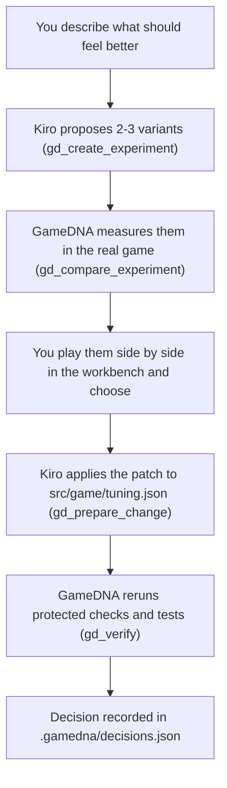
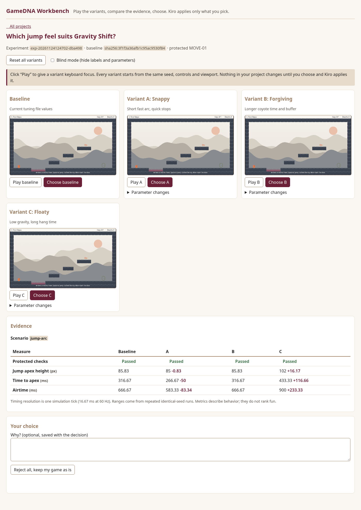
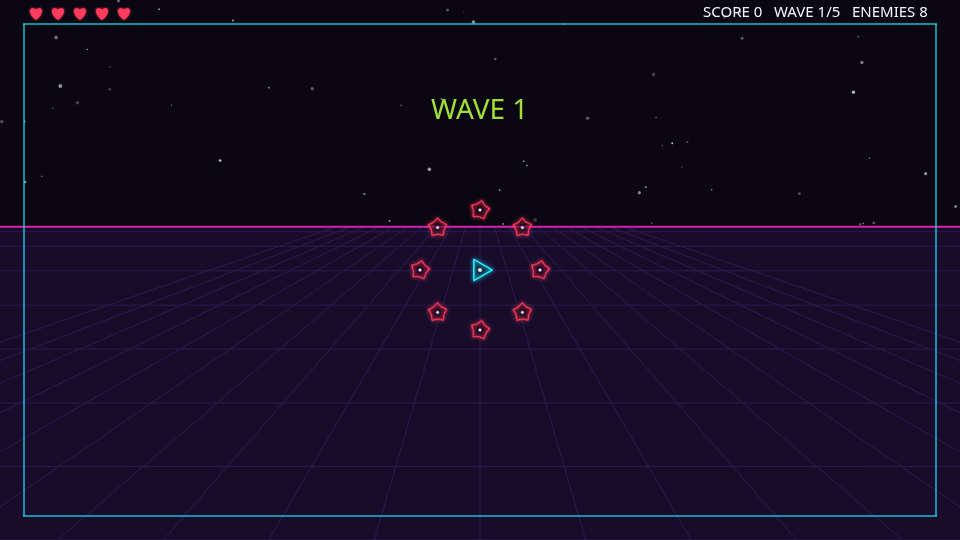
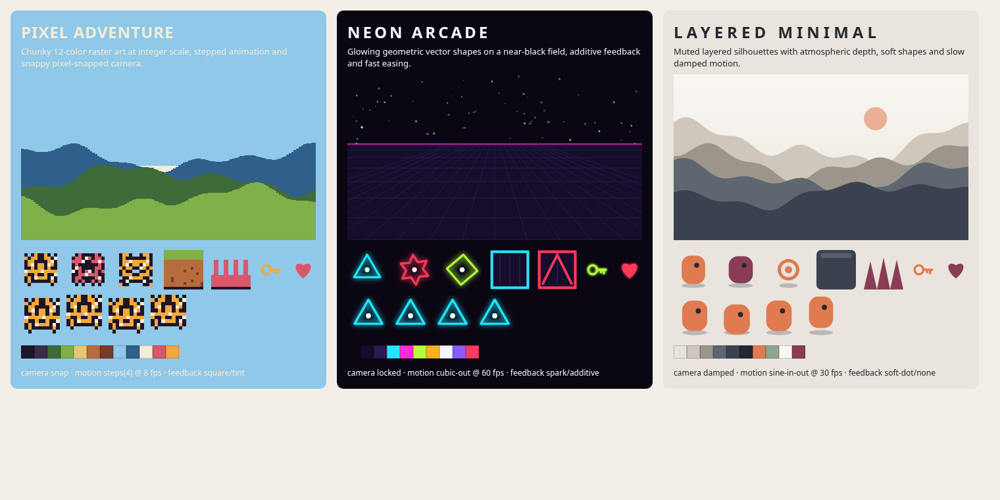

# GameDNA

GameDNA turns Kiro into a specialist game developer for Phaser games. It is a Kiro Power with a local MCP server that gives Kiro game-design skills, procedural art and sound, the ability to watch and replay a running game, and playable A/B/C experiments where **you** choose the result. Kiro then applies your choice to normal game source and verifies that the game's protected rules still hold.

Built for **Kiroween 2026** (Skeleton Crew category): two different games, `apps/gravity-shift` and `apps/neon-survivor`, built on one shared starter, `packages/starter`.


## The refinement loop





## What is in the box

| Path | What it is |
|---|---|
| `power/` | The Kiro Power: `plugin.json`, `mcp.json`, six skills (game direction, game feel, technical art, level design, playtesting, refinement) and the bundled server |
| `packages/mcp` | 15 MCP tools: project status, style packs, design validation, asset generation, sessions, observation, scenarios, experiments, selection, change preparation, verification, reports |
| `packages/core` | Schemas, deterministic scenario runner, assertions, trace comparison, metrics, experiments and decisions |
| `packages/assets` | Three style packs and seeded generators for sprites, tiles, backgrounds, icons, particles and sound effects |
| `packages/phaser-adapter` | Development-only bridge (`window.__GAMEDNA__`), never in production builds |
| `packages/starter` | The shared lean game skeleton: fixed-step simulation base and Phaser scene glue |
| `packages/workbench` | Local comparison UI |
| `apps/gravity-shift` | Gravity-reversing puzzle platformer, layered-minimal style |
| `apps/neon-survivor` | Top-down wave survival, neon-arcade style |





## Quick start

```bash
npm install
npx playwright install chromium
npm test            # 92 tests
npm run build       # workbench, Power bundle, both games, bridge check
npm run dev -w gravity-shift   # http://127.0.0.1:5173
npm run dev -w neon-survivor   # http://127.0.0.1:5174
```

Open the folder in Kiro: `.kiro/settings/mcp.json` starts the GameDNA server. Then ask, for example, "Use GameDNA to make Gravity Shift's jump feel better and let me choose." Full instructions: [docs/INSTALL.md](docs/INSTALL.md).

## Design choices

- **TypeScript on Node 22** for the whole stack, after comparing Rust, Go, Python and Bun. One language lets the same scenario runner execute in Vitest, in the browser and in the server. Warmed MCP calls measure under 5 ms at p95 ([docs/BENCHMARKS.md](docs/BENCHMARKS.md)).
- **Deterministic fixed-step simulations.** Game rules are plain TypeScript classes; Phaser only draws them. Scenarios replay exactly, and five identical-seed runs match exactly.
- **One browser round trip per scenario.** The adapter runs all ticks in the page.
- **You stay in control.** Experiments never touch your files. Only a recorded user choice can be applied, and a changed baseline makes the choice stale.
- **Honest results.** Every check reports passed, failed, not tested, unsupported or unstable. A tool failure is never a pass.

## Kiro usage

The spec that drove this build is in `.kiro/specs/gamedna-mvp/`, with steering in `.kiro/steering/` and hooks in `.kiro/hooks/`. Each game has its own spec in `apps/*/.kiro/specs/game/`.

## Project documents

[PRD](docs/GameDNA_PRD_v1.1_Kiroween.md) · [Install](docs/INSTALL.md) · [Benchmarks](docs/BENCHMARKS.md) · [Originality](docs/ORIGINALITY.md) · [Dependencies](docs/DEPENDENCY_INVENTORY.md) · [Third-party notices](docs/THIRD_PARTY_NOTICES.md) · [Docs rules](docs/rules.md)

## License

MIT. See [LICENSE](LICENSE).
