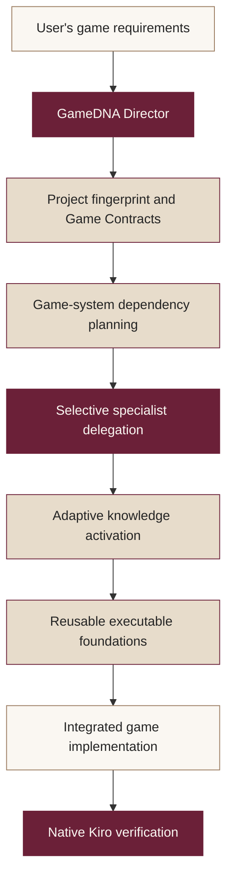
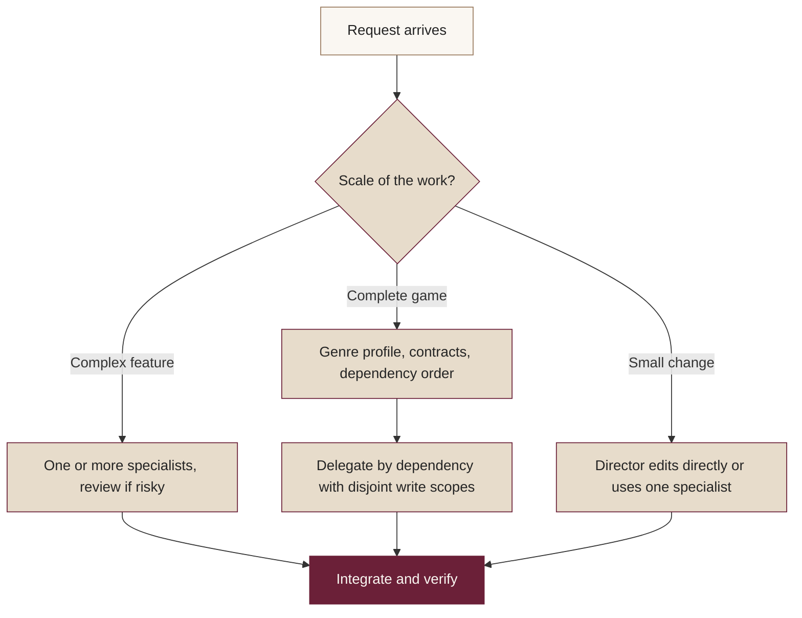
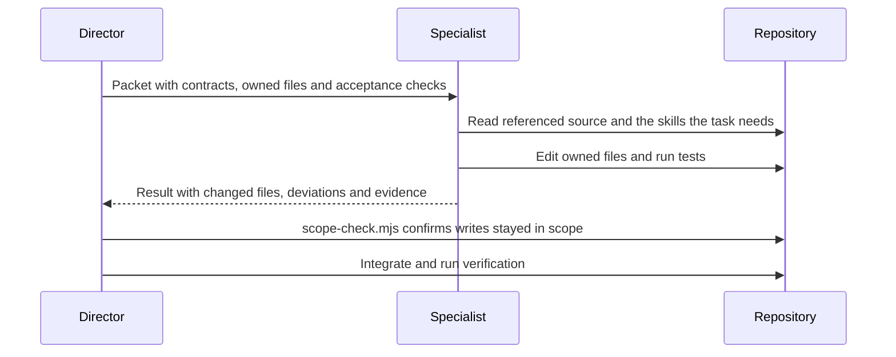

# 🧬 GameDNA 2.0 architecture

GameDNA gives Kiro the knowledge of experienced game developers, a tested game-code foundation and a small team of focused specialist agents. Kiro stays in charge of reasoning, planning, implementation, delegation, debugging and verification. GameDNA is not a game engine, a separate coding agent, an inference service or a replacement for Kiro.

Reading key:

| Symbol | Meaning |
|---|---|
| 💡 | Summary |
| 🧱 | Components and boundaries |
| 🎬 | The Director |
| 🪪 | Project fingerprint |
| 📐 | Game Contracts |
| 👥 | Specialist agents |
| 🧠 | Knowledge activation |
| 🏭 | Reusable foundation |
| 🧪 | Verification |
| 🎯 | Design principles |
| 🚧 | Known limitations |

## 💡 1. Summary

GameDNA 1.x was built around its own MCP server: browser sessions, a runtime observation pipeline, mandatory A/B/C experiments, a comparison workbench and a decision lifecycle. Kiro already runs commands, browsers and tests natively, so that stack duplicated Kiro and made every change cost extra tool calls and a user choice. GameDNA 2.0 removes it and moves the value into three things Kiro cannot produce on its own:

- **Knowledge with sharp boundaries.** Skills that each own one decision area, name their neighbors, point at tested code and keep engine-specific detail in references that load only when needed.
- **Executable foundations.** The GameDNA Kit, the 2D starter and the asset generators. Agents reuse tested modules instead of regenerating known algorithms from prose.
- **Coordination.** A compact Director, specialist roles with scoped discovery, Game Contracts for shared interfaces and a lightweight delegation packet.

### 1.1 What GameDNA is not

- It runs no server, scheduler, queue or agent harness. Every layer below is a responsibility carried by Kiro's native features: skills, custom agents, sub-agents, steering and ordinary commands.
- It does not choose between generated variants. One implementation is built and verified per request unless the user asks for alternatives.
- It does not claim engine support it has not tested. Phaser 3.90 and three.js 0.170 are supported. Other engines are detected and reported as unsupported.

## 🧱 2. Layers

The layers are responsibilities, not a fixed sequence of tool calls. A one-line change skips straight to implementation and verification. This diagram shows the full path for a complete game.

### 2.1 Where each layer lives

| Layer | Carried by | Location |
|---|---|---|
| Director | Custom agent (IDE, CLI) or skill (Web and Power-only installs) | `integration/kiro/agents/gamedna-director.md`, `power/skills/gamedna-director/` |
| Project fingerprint | Dependency-free Node script writing a compact profile | `power/skills/gamedna-director/scripts/fingerprint.mjs`, output `.gamedna/profile.json` |
| Game Contracts | Typed source module plus one short Markdown file | `@gamedna/kit/contracts`, `src/contracts.ts`, `.gamedna/contract.md` |
| Dependency planning | Section of the Director skill; ownership check script | `power/skills/gamedna-director/references/delegation.md`, `scripts/scope-check.mjs` |
| Specialist delegation | Native Kiro sub-agents | `integration/kiro/agents/gamedna-*.md` |
| Knowledge activation | Native skill discovery, scoped per agent with `skill://` resources | `power/skills/*/SKILL.md` and `references/` |
| Executable foundations | Workspace packages | `packages/kit`, `packages/starter`, `packages/assets`, `packages/core` |
| Verification | Kiro running tests, builds and browsers | `npm test`, `npm run test:e2e`, Playwright |

## 🎬 3. The Director

The Director understands the player experience the user wants, establishes direction and coordinates. It does not implement every subsystem itself. Its permanent instructions are the body of `power/skills/gamedna-director/SKILL.md`, kept to roughly 500 to 900 tokens. Genre profiles, the contract template, the delegation format and the quality principles are references it opens only when the current request needs them.

Responsibilities, in the order they usually arise:

1. Read the request and the stored profile. Run the fingerprint only when the profile is missing or stale.
2. Decide the scale: small change, complex feature or complete game.
3. For a complete game, read the matching genre profile to find systems the request did not name.
4. Write or update the Game Contracts that more than one subsystem depends on.
5. Order the work by dependency, assign one owner per writable file set, and delegate.
6. Integrate results, resolve contract conflicts, run verification and report evidence.

This flow shows how the Director scales its work to the request.

### 3.1 Surfaces

| Kiro surface | How the Director runs |
|---|---|
| IDE, CLI | Select the `gamedna-director` custom agent. Its prompt loads the Director skill body as a `file://` resource. |
| Web | Custom agents run only as sub-agents, so the main agent activates the `gamedna-director` skill and delegates to installed specialists. |
| Power only, no agents installed | The main agent follows the Director skill and loads domain skills itself. No delegation. |

## 🪪 4. Project fingerprint

`fingerprint.mjs` reads manifests, lockfiles, source imports and entry points, never file extensions alone. It writes `.gamedna/profile.json` with each fact, its evidence (file and line) and a hash of the inputs it read. A later run with `--check` reports whether the profile is stale without rescanning source. In a monorepo the `--app` option fingerprints the targeted application, so a Phaser app and a three.js app in one repository get separate profiles.

Facts recorded: engine and installed version, language, build tool, dependency versions, dimension, rendering approach, physics approach, input devices found in source, existing GameDNA modules, entry points and target platforms. Genre and performance targets are recorded only when the user or the contract states them, because source code does not reveal them reliably.

## 📐 5. Game Contracts

A contract holds only what crosses a subsystem boundary. Technical contracts are typed source; creative and experiential constraints are a short Markdown file. A small game needs one `.gamedna/contract.md`. A game built by several specialists adds `src/contracts.ts`, created with `defineContracts` from `@gamedna/kit/contracts`, which validates units, timestep, budgets and event names at startup and in tests.

| Contract | Holds | Usual form |
|---|---|---|
| Spatial | Units, axes, ground plane, scales, bounds, transform ownership | Typed |
| Simulation | Timestep, authoritative state, owners, update order, collision interfaces, determinism | Typed |
| Gameplay | Core loop, actions, rules, state transitions, events, objectives | Typed events, Markdown rules |
| Interaction | Semantic actions, device mappings, camera targets, accessibility | Typed |
| Visual | Art direction, shape language, palette, materials, lighting, effects intensity | Markdown |
| Performance | Target hardware, frame rate, memory, draw-call and simulation budgets, quality scaling | Typed budgets |
| Integration | Public module interfaces, dependency direction, file ownership | Markdown table |

The Director owns contract changes. A specialist that cannot meet a contract reports the conflict in its result instead of changing the interface.

## 👥 6. Specialist agents

Nine roles are available. They are not nine running agents: the Director starts only the roles a task needs, and most small tasks start none.

| Agent | Owns | Skills it discovers |
|---|---|---|
| `gamedna-gameplay` | Mechanics, combat, AI, progression, game flow, saves | `game-mechanics`, `enemy-ai`, `game-architecture` |
| `gamedna-simulation` | Timestep, physics, collision, controllers, vehicle dynamics | `fixed-step-simulation`, `collision-and-response`, `character-movement`, `vehicle-dynamics` |
| `gamedna-world` | Terrain, roads, layouts, procedural levels, scatter | `world-generation`, `level-design` |
| `gamedna-visual` | Look, materials, lighting, post, particles, generated assets | `art-direction`, `rendering-and-lighting`, `procedural-assets` |
| `gamedna-motion` | Character and vehicle construction and animation | `character-animation`, `vehicle-design` |
| `gamedna-interaction` | Input abstraction, devices, cameras | `input-and-controls`, `camera-systems` |
| `gamedna-experience` | Game feel, HUD, menus, audio, pacing, onboarding | `game-feel`, `hud-and-menus`, `audio-design`, `pacing-and-onboarding` |
| `gamedna-performance` | Profiling, budgets, pooling, instancing, disposal | `performance-budgets` |
| `gamedna-quality` | Independent review and runtime verification | `game-verification` |

Every specialist also discovers `threejs-kit` and `phaser-starter`, so engine-specific guidance matches the project. Specialists have no `subagent` tool. Nested delegation is prevented by configuration: a specialist that needs another domain asks the Director in its result.

### 6.1 Delegation packet and result

A packet names the task, objective, contracts that apply, owned files, interfaces, constraints and acceptance checks. It points at source files rather than pasting them. A result reports status, changed files, public API changes, decisions, contract deviations, verification performed, unverified areas and blockers, in about 100 to 300 tokens. The formats are in `power/skills/gamedna-director/references/delegation.md`.

This sequence shows one delegated task.

### 6.2 Write ownership

Every writable subsystem has one owner. Parallel delegation is used only for disjoint write scopes. `scope-check.mjs` compares `git diff --name-only` against the packet's owned globs, so a write outside scope is detected by a command, not trusted to a prompt. When scopes overlap, the Director runs the tasks in sequence or uses separate Git worktrees.

## 🧠 7. Knowledge activation

Knowledge is organized in four depths and loaded as late as possible.

| Depth | Content | Loaded |
|---|---|---|
| 1. Discovery | Skill `name` and `description`, about 30 to 80 tokens, ending with what the skill does not own | At session start, scoped per agent |
| 2. Guidance | `SKILL.md` body: decisions, invariants, techniques, mistakes, reuse | When a decision in that area arises |
| 3. References | `references/*.md`, often one per engine or one deep topic | When the body points to it for the current case |
| 4. Executable | Kit, starter and asset modules, scripts | Imported or run instead of rewritten |

### 7.1 Three discovery scopes

- **Global.** The Director sees the specialist agent descriptions and the Director skill. It does not need the domain catalog.
- **Specialist.** Each agent's `resources` list only its own skills and the two engine skills.
- **Task.** The specialist opens the one skill or reference its current decision needs. Each skill body names its neighbors, so a real cross-domain dependency leads to the right skill by name.

### 7.2 Activation during implementation

Activation is not a one-time classification of the first prompt. Each skill and each specialist prompt tells the agent to look again for knowledge when it starts a new subsystem, meets an unfamiliar API, defines an interface, changes approach, finds a cross-system dependency, diagnoses a defect, hits a performance limit or changes engine or platform. It does not re-route on every turn and does not reread a skill already in context. Kiro has no unload operation, so a loaded skill stays in context until compaction or a fresh sub-agent.

### 7.3 Ownership rules

Every skill declares one owning role and a topic list in its `metadata`. `scripts/validate-knowledge.mjs` fails the build when two skills claim the same topic, a reference is broken, a Kit module named in a skill does not exist, an engine version disagrees with the pinned dependency, or a cross-skill load instruction is unconditional.

## 🏭 8. Reusable foundation

GameDNA stays a real software foundation. Modules are small, typed, tested and built on engine features rather than replacing them.

| Package | Role |
|---|---|
| `@gamedna/kit` | Portable game modules (random, loop, input, collision, controllers, handling, AI, navigation, events, saves, inventory, level generation, pooling, feedback, contracts) and three.js presentation (camera, character, vehicle, world, stage, disposal) |
| `@gamedna/starter` | The lean 2D skeleton: fixed-step simulation base and Phaser scene glue |
| `@gamedna/assets` | Seeded generators for sprites, tiles, backgrounds, icons, particles and sound |
| `@gamedna/core` | Deterministic scenario runner, assertions, traces and metrics for tests |

Agents check for a suitable module before writing a game system. Game-specific behavior stays in the application. Games built with GameDNA run without Kiro.

## 🧪 9. Verification

Kiro owns verification and uses ordinary commands: type checking, unit, property and scenario tests, production builds and Playwright browser tests. A passing build is not evidence of a polished game, and a screenshot is not evidence of working gameplay. Agents report what they ran and what they could not run.

## 🎯 10. Design principles

These principles guide recurring decisions. They are written out in `power/skills/gamedna-director/references/principles.md`, which agents open when a decision needs one.

| Principle | Meaning |
|---|---|
| Experience coherence | Every major subsystem serves the intended player experience |
| Physical credibility | Scale, motion, animation and interaction follow the game's physical or stylized rules |
| Perceptual responsiveness | Input produces timely, readable visual, motion and audio feedback |
| Spatial legibility | Players can read surroundings, objectives, actions and threats |
| Mechanical depth | Mechanics create decisions, not surface complexity |
| Visual consistency | Geometry, color, materials, effects, lighting and UI belong to one world |
| State integrity | Game-state ownership and transitions stay explicit |
| Resource awareness | Visual and simulation cost respects the target hardware |
| Composability | Systems integrate through clear interfaces |

## 🚧 11. Known limitations

- Kiro Web runs custom agents only as sub-agents, so the Director there is a skill followed by the main agent. Whether a sub-agent may start further sub-agents is not documented, which is one reason specialists have no `subagent` tool.
- Kiro documents no `skill://` path for skills inside an installed Power. Scoped specialist discovery therefore needs the installer, which copies skills into `.kiro/skills/`.
- Native skill-activation telemetry is not exposed to GameDNA. The routing evaluation in `evaluations/` is a simulated selection study and is labeled as such.
