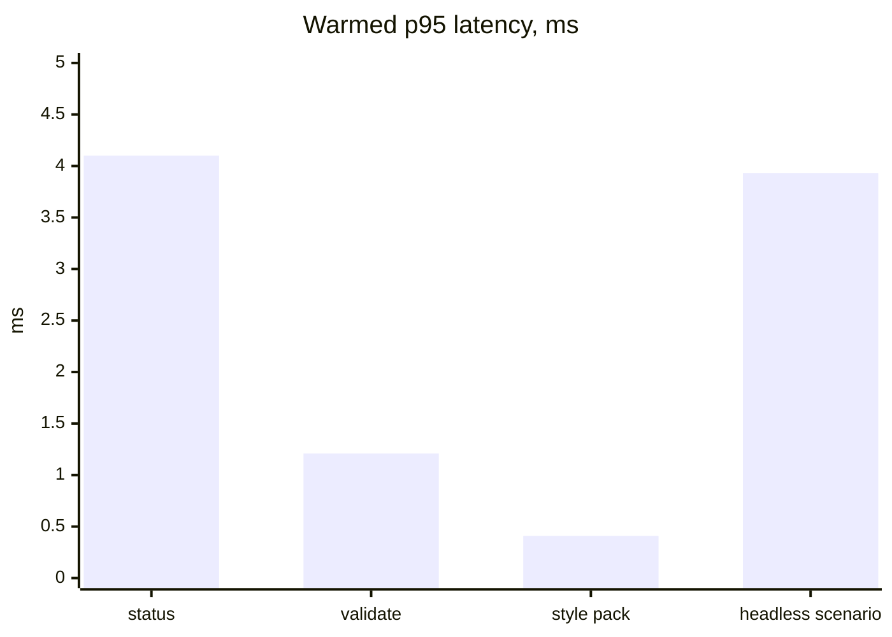
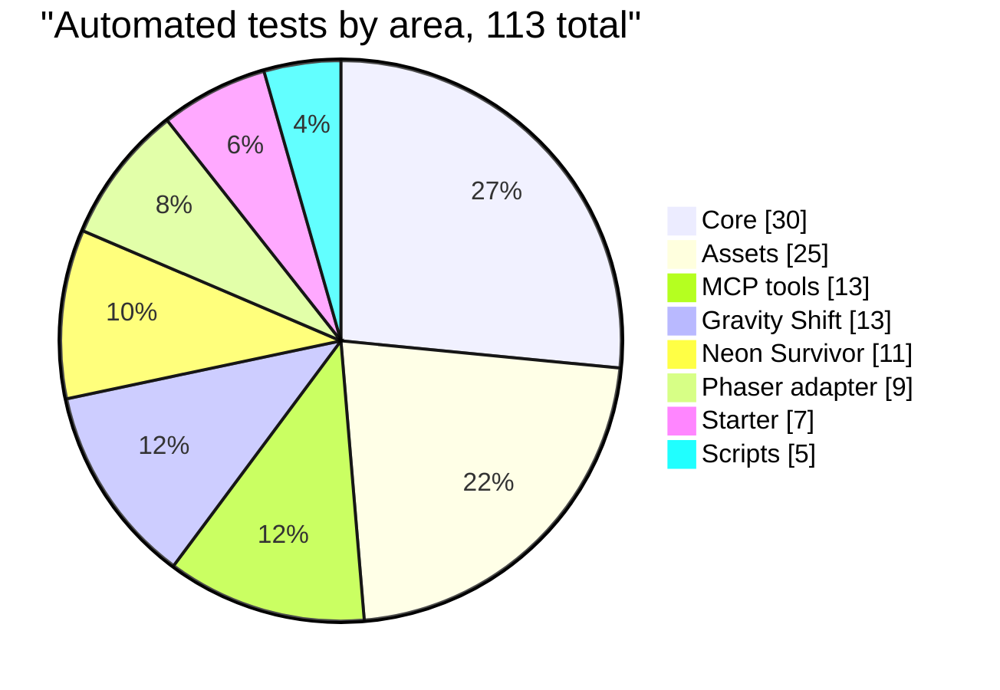

# 🧬 GameDNA benchmarks

Measured results for the MVP on one machine. These are measurements, not promises. Rerun them with `npm run bench:mcp` and `npm test`.

Reading key for this document:

| Symbol | Meaning |
|---|---|
| ⏱️ 🔁 🧪 | Section icons, defined in `docs/rules.md` section 2 |
| Bar chart | Counts or values per item. Read the axis. |
| Pie chart | Share of items in each category. Read the slice labels. |

Machine: AMD EPYC 7R13, 8 vCPU, 31 GiB RAM, Linux 6.1 (Amazon Linux 2023), Node.js 22.23.4, headless Chromium 159 (Playwright 1.65.1). Measured on 24 November 2026.

## ⏱️ 1. Latency

`scripts/bench-mcp.mjs` starts the bundled server over real stdio, waits for the tool list, then calls each tool 55 times and drops the first 5 as warm-up.

| Measurement | Calls | p50 | p95 | Max |
|---|---|---|---|---|
| Cold start to tool list (15 tools) | 1 | 144.9 ms | n/a | n/a |
| `gd_project_status` | 50 | 2.64 ms | 4.10 ms | 4.74 ms |
| `gd_validate_design` | 50 | 0.87 ms | 1.21 ms | 1.24 ms |
| `gd_get_style_pack` | 50 | 0.29 ms | 0.41 ms | 0.43 ms |
| `gd_run_scenario`, headless, 120 ticks | 50 | 2.71 ms | 3.93 ms | 4.61 ms |

The PRD 10.2 target is p95 under 250 ms for warmed status and validation calls. Measured p95 is 4.10 ms and 1.21 ms.

The bar chart below shows the warmed p95 values from the table above, in milliseconds.

Browser-session timings from one end-to-end run (`gd_start_session` through `gd_stop_session` on Gravity Shift):

| Step | Time |
|---|---|
| `gd_start_session` (spawn Vite, launch Chromium, wait for bridge) | 1869 ms |
| `gd_observe` with screenshot | 186 ms |
| `gd_run_scenario`, 1 run, browser | 54 ms |
| `gd_run_scenario`, 5 repeats plus 3 checkpoint screenshots | 818 ms |
| `gd_compare_experiment`, 4 variants, 2 repeats each, with screenshots | 2560 ms |
| `gd_verify` with page reload and project tests | 1934 ms |

A browser scenario costs one `page.evaluate` round trip because the adapter runs every tick in the page. This design choice is why TypeScript was kept over Rust (see `.kiro/specs/gamedna-mvp/design.md` section 1): the latency comes from browser round trips, not from the server language.

## 🔁 2. Reproducibility

| Scenario | Runtime | Runs | Result |
|---|---|---|---|
| `jump-arc` (Gravity Shift) | Browser | 5 | Stable, exact match of events and sampled state |
| `jump-arc` (Gravity Shift) | Headless | 5 | Stable, exact match |
| `combat-feel` (Neon Survivor) | Headless | 5 | Stable, exact match |

The simulations are fixed-step with seeded random numbers, so exact equality is expected. Any divergence would be reported as `unstable`; none occurred in these runs. This covers the tested Chromium and Node versions only.

## 🧪 3. Test coverage

| Area | Tests | What they cover |
|---|---|---|
| Core | 30 | PRNG, schemas, scenario runner, assertions, traces, decisions, experiments, design validation, path guard, revisions |
| Assets | 25 | Byte determinism for 18 pack and type pairs, validation diagnostics, PNG and WAV headers |
| MCP tools | 13 | Engine detection, command allowlist, path restrictions, headless runs, seeded fault detection, full experiment loop, stale baseline, report, workbench security |
| Gravity Shift | 13 | Scenarios, seeded fault, reproducibility, metric response, fast-check properties for MOVE-01, DEAD-01 and RESET-01 |
| Neon Survivor | 11 | Scenarios, seeded fault, reproducibility, metric response, fast-check properties for CD-01, SCORE-01, HP-01 and RESET-01 |
| Phaser adapter | 9 | URL overrides, allowlist rejection, in-page scenarios equal headless runs, checkpoints, bounded stepping, event paging |
| Starter | 7 | Input edges, fixed-step clock cap, tuning helpers, seeded determinism |
| Scripts | 5 | Production bridge check, license copy, docs rules checker |

The pie chart below shows the share of the 113 unit, property and scenario tests in each area, from the table above.

`npm run test:e2e` adds 7 browser end-to-end tests: the bundled server over stdio, a real dev server and Chromium, a workbench click that records the choice, a verified decision, and both production builds loading without the bridge. CI runs all of them on every pull request (`.github/workflows/ci.yml`).

Not yet measured: the controlled comparison against ordinary Kiro (PRD 10.3), the user pilot and clean installs on a second machine.
