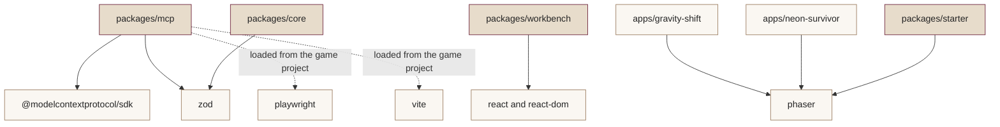

# 🧬 GameDNA dependency inventory

This inventory lists every direct third-party dependency, its pinned version, purpose and license. The lockfile `package-lock.json` is committed and pins every transitive package.

Reading key for this document:

| Symbol | Meaning |
|---|---|
| 🗃️ 🗺️ | Section icons, defined in `docs/rules.md` section 2 |
| Architecture flowchart | Components and how they connect |

## 🗃️ 1. Dependencies

| Package | Version | Purpose | License | Source | Ships in |
|---|---|---|---|---|---|
| `phaser` | 3.90.0 | Game engine for both demo games | MIT | https://github.com/phaserjs/phaser | Game builds |
| `@modelcontextprotocol/sdk` | 1.32.2 | MCP stdio server | MIT | https://github.com/modelcontextprotocol/typescript-sdk | `power/server` bundle |
| `zod` | 4.6.7 | Schema validation at trust boundaries | MIT | https://github.com/colinhacks/zod | `power/server` bundle, dev bridge |
| `react`, `react-dom` | 19.3.1 | Workbench UI | MIT | https://github.com/facebook/react | `power/server/workbench` |
| `playwright` | 1.65.1 | Headless Chromium for sessions and screenshots | Apache-2.0 | https://github.com/microsoft/playwright | Not bundled; loaded from the game project |
| `vite` | 7.3.8 | Dev server, builds, headless harness loading | MIT | https://github.com/vitejs/vite | Development only |
| `@vitejs/plugin-react` | 5.2.0 | JSX transform for the workbench build | MIT | https://github.com/vitejs/vite-plugin-react | Development only |
| `vitest` | 4.1.12 | Test runner | MIT | https://github.com/vitest-dev/vitest | Development only |
| `fast-check` | 4.11.0 | Property-based tests | MIT | https://github.com/dubzzz/fast-check | Development only |
| `typescript` | 5.9.3 | Type checking | Apache-2.0 | https://github.com/microsoft/TypeScript | Development only |
| `esbuild` | 0.28.2 | Bundles the MCP server | MIT | https://github.com/evanw/esbuild | Development only |
| `tsx` | 4.23.15 | Runs TypeScript asset scripts | MIT | https://github.com/privatenumber/tsx | Development only |
| `@types/node`, `@types/react`, `@types/react-dom` | 22.20.5, 19.3.0, 19.3.0 | Type definitions | MIT | https://github.com/DefinitelyTyped/DefinitelyTyped | Development only |

A scan of `node_modules` on 24 November 2026 found 205 installed packages under these licenses: MIT 182, ISC 13, Apache-2.0 5, BSD-3-Clause 3, BSD-2-Clause 1, CC-BY-4.0 1. The CC-BY-4.0 package is `caniuse-lite`, a browser data table used only by build tooling. None of these packages is a game template, sample game or existing MCP server.

No fonts, images, audio or art packs are installed. Games use system fonts and GameDNA-generated assets.

## 🗺️ 2. Dependency usage

The architecture flowchart below shows which first-party package uses each runtime dependency from the table in section 1.

Production game bundles contain Phaser and first-party code only. `scripts/check-prod-bridge.mjs` confirms that the dev bridge, and with it Zod, stays out of them.
