# <span style="color:#B84D73">🧬 GameDNA — Product Requirements Document</span>

> **Turn Kiro into an experienced, specialized game developer.**
>
> An installable game-development Power and local MCP toolset that equips Kiro with professional game-design knowledge, procedural asset production, runtime observability, playable experiments and evidence-driven refinement — using the developer's existing Kiro subscription.

Reading key for this document:

| Symbol | Meaning |
|---|---|
| 🔴 P0 | Essential for the hackathon MVP |
| 🟠 P1 | Desirable after the P0 scope is stable |
| 🔵 P2 | Later |
| Flowchart | Steps and decisions, read top to bottom |
| Sequence | Messages between actors, read top to bottom |
| State | Statuses and the events that move between them |
| Pie, bar and Gantt | Counts and schedule. Read the slice labels, the axis or the dates. |

| Document metadata | Value |
|---|---|
| Version | 1.1 — clean-slate Kiroween compliance baseline |
| Date | 24 November 2026 |
| Status | Build-ready proposal; implementation and benchmarks pending |
| Product | GameDNA |
| Distribution | Open-source Kiro Power + local MCP server + local companion workbench |
| Initial audience | Indie developers, students, game-jam participants and web developers |
| Initial supported engine | Phaser, pinned to a tested version; TypeScript |
| Competition | Kiroween 2026; proposed Skeleton Crew category |
| License | MIT for newly authored GameDNA code; licensed standard dependencies separately tracked |
| Originality policy | No reused pre-existing project code, templates, skills, assets or game implementations |
| Eligible build window | October 30, 2026, 9:00 AM PDT – December 4, 2026, 2:00 PM PST (October 30, 9:30 PM IST – December 5, 3:30 AM IST) |

## <span style="color:#B84D73">💡 1. Executive summary</span>

GameDNA is a specialist capability for Kiro, not another AI coding application, game engine or general-purpose game generator. Kiro continues to own conversation, reasoning, planning, code generation and edits. GameDNA gives it the domain expertise and instruments that an experienced game developer uses to make decisions and refine a playable game.

A user installs GameDNA inside Kiro and describes a game in ordinary language. Kiro helps them choose an original direction, formalizes the design in Kiro Specs, writes native game code, constructs appropriate procedural visuals, launches the game, inspects its behavior, generates focused playable alternatives, gathers the user's preference, applies the chosen design and verifies that existing functionality is preserved. It repeats the process within an explicit iteration budget.

The primary invention is the **GameDNA refinement loop**: creative intent → persistent design decisions → actual playable implementation → measured observations and playable variants → human selection → verified change. The GameDNA record preserves approved decisions across sessions and exposes the evidence behind them.

The flowchart below shows one pass through the refinement loop.

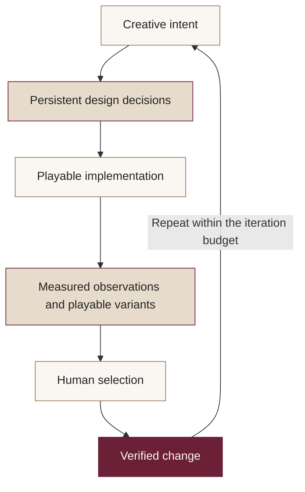

This combination is the proposed differentiation. Neither individual ingredients such as game-design prompts, procedural graphics, MCP playtesting, nor A/B tuning are new by themselves. GameDNA must demonstrate that combining them in a Kiro-native workflow produces measurably better games with less manual refinement.

### <span style="color:#9A7B5F">1.1 Mandatory clean-slate implementation policy (P0)</span>

> [!IMPORTANT]
> This PRD is an implementation brief for a **new project**, not permission to reuse another codebase. Official Kiroween rules [R18], under Project Requirements, permit standard development resources such as frameworks, libraries and starter templates, require disclosure of other incorporated pre-existing work, and require the submitted work to be created during the submission period. GameDNA adopts a stricter project-specific policy: no pre-existing project implementation or starter template may be incorporated, even if reuse would otherwise be allowed with disclosure.

**Rules for Kiro and every contributor:**

- Start with a new, empty Git repository. Do not fork, clone as a foundation, import, port, adapt or copy implementation from existing projects, including the entrant's own older repositories, Vox-Style-Motion-mcp, vox-style-power, existing game MCPs, prior hackathon entries, sample games, template repositories or published code recipes. Do not use a scaffold generator that imports an existing game/application template; write the initial application files and configuration afresh.
- All GameDNA-specific source, MCP handlers, runtime bridges, local workbench, skills, Power manifest/configuration, style packs, procedural generators, test fixtures, documentation, and both demo games must be newly authored with Kiro during the eligible window. No pre-made game assets, external art packs, copied shaders, existing levels, pre-recorded gameplay or externally sourced sample projects in the judged implementation.
- Standard third-party dependencies (e.g. Phaser, React, TypeScript, MCP SDK, Zod, Playwright, Vite, Vitest, fast-check) remain allowed as pinned packages used through their public APIs. The project is not required to reimplement a game engine or standard libraries. Do not vendor or modify existing project code to create the product. Use original procedural assets, original audio synthesis, or system fonts; account for the licenses of any distributed font/tool dependency.
- Research papers, official API documentation and competitor descriptions may inform requirements, mathematical methods, architecture and public API use. Cite them; do not copy their implementation, code samples, art, text or proprietary materials into GameDNA. Write fresh implementations against documented interfaces. Kiro must not be instructed to retrieve or reproduce an existing project implementation.
- Keep Kiro as the development and runtime reasoning interface; no separate LLM provider, copied AI-agent harness or alternative coding agent is required. Record real Kiro Specs, steering, hooks and actual development usage rather than manufacturing evidence after completion.
- The hackathon submission and comparisons may use only newly authored demonstration games and newly authored baseline prototypes created during the window. Compatibility with a user's pre-existing Phaser game is a product use case, not permission to import an existing game into the contest entry.
- Maintain a dependency/license inventory and provenance records for authored code, skills, assets and demos. If uncertain whether a component is original, authorized or eligible, stop incorporating it, document the concern and replace it with a fresh implementation or seek written organizer guidance. Never obscure reuse, fabricate authorship, alter timestamps to misrepresent work, or claim that commit dates alone prove originality.

Acceptance: all submitted first-party artifacts are traceable to the eligible development period; the public repository starts with a fresh initial history; dependency and asset inventories are reviewed; the entrant attests that no pre-existing project code or assets were deliberately incorporated. No claim of zero reuse is valid until this audit is actually completed. Organizer decisions remain controlling; this policy is a compliance design, not an eligibility certification.

### <span style="color:#9A7B5F">Non-negotiable product boundaries</span>

- Kiro is the only AI reasoning/model provider required for the core workflow. Users use their own authorized Kiro account, selected available model and applicable credit allocation.
- GameDNA does not obtain Kiro authentication tokens, proxy the subscription, expose a model API, run an independent AI orchestrator or sell Kiro credits.
- Existing engines remain responsible for rendering, input, physics, audio and execution. GameDNA does not introduce a proprietary game runtime, scripting language or engine.
- The user's output is ordinary, readable, editable game source and a playable build. The finished game must not require Kiro, an LLM, the MCP server or an active GameDNA account to run.
- Core MVP requires no separate paid asset-generation API, no cloud rendering and no custom model training. Optional external services may be introduced later with explicit consent and their own terms.
- Quality means observed craftsmanship and approved preferences, not a claim that AI can guarantee a commercially successful or universally fun game.

## <span style="color:#B84D73">🔎 2. Problem definition and research</span>

### <span style="color:#9A7B5F">2.1 User pain</span>

AI coding assistants can create a functional prototype, yet developers still have to make dozens of interconnected creative and technical decisions: movement acceleration, jump timing, feedback, camera behavior, visual hierarchy, asset consistency, onboarding, level difficulty, pacing, and performance. A text description like “make it feel satisfying” does not specify what changes should be made or how success should be assessed.

The common failure mode is a one-shot implementation followed by subjective trial-and-error prompts. The agent may not be able to observe the game in motion, remember why a tuning choice was made, reproduce a failed input sequence, or distinguish a real improvement from a change that merely compiles. Expert developers use interactive experimentation, measurable feedback and repeated testing instead.

### <span style="color:#9A7B5F">2.2 Research basis</span>

The peer-reviewed survey *Designing Game Feel* identifies physicality, amplification and support as important design domains; their associated practices include tuning, juicing and streamlining [R1]. The empirically grounded study on juicy design provides additional practitioner-oriented framing for audiovisual feedback [R2]. These sources motivate GameDNA's skills and instruments; they do not establish that more effects always make games better. User preference and accessibility still matter.

Kiro already provides structured requirements/design/tasks and property-based correctness testing [R3–R4]. Its Power architecture provides installable, dynamically activated skills and MCP tools [R5–R7]. These are existing Kiro capabilities that GameDNA should extend rather than reproduce. Kiro's subscription FAQ permits use across its official development surfaces and compatible ACP IDEs [R8]; GameDNA's MVP stays in the IDE using local MCP, avoiding any assumption of direct model API access.

### <span style="color:#9A7B5F">2.3 Competitive landscape</span>

| Existing solution | Relevant overlap, documented in its public materials | GameDNA's proposed differentiation |
|---|---|---|
| AWS Agentic Arcade [R9] | AI-assisted game concept, assets, Kiro specifications, playtester recommendations | Persistent, repository-owned design decisions and controlled playable experiments during ongoing development, not just prototype creation |
| Kiro Multi-Agent Game Studio [R10] | Domain-specific agents, Powers and integrations across game-development tools | Focus on a measurable, human-in-the-loop refinement cycle and reusable experiment evidence instead of breadth of agent roles |
| Godot Forge MCP [R11] | Game development guides, runtime inspection, playtesting, fixing and polishing | Phaser-first, actual same-project A/B comparisons with explicit preference persistence and regression gates |
| Godot MCP Toolkit [R12] / Ziva [R13] | Editor operations, screenshots, runtime state, input simulation and AI-assisted playtesting | Game-quality decisions linked to comparable experiments, requirements and durable provenance |
| Game Feel Lab [R14] | Interactive tuning, jump curves, A/B comparisons and feedback controls | Apply experiments to the developer's actual game, have Kiro implement the selected result, and verify surrounding gameplay after the change |
| Phaser [R15] | Existing scene, rendering, physics, input and camera framework | GameDNA supplies design expertise and development-time inspection; Phaser remains the game engine |

> [!CAUTION]
> These are overlapping products, not claims that their functionality stops at the listed features. A broader competitor audit and real benchmark are required before making superiority claims. Do not describe GameDNA as the first AI game developer, first game MCP or first game-feel tool.

## <span style="color:#B84D73">🧭 3. Product strategy</span>

### <span style="color:#9A7B5F">3.1 Vision</span>

Make expert-quality game-development practices accessible to people who can describe a game but lack years of experience in game design, technical art, gameplay programming and quality assurance.

### <span style="color:#9A7B5F">3.2 Target personas and jobs to be done</span>

| Persona | Job to be done | Success outcome |
|---|---|---|
| First-time game creator | Turn a vague idea into a coherent playable game without learning all specialist tools first | Gets a complete small game with a consistent aesthetic, clear controls and a satisfying loop |
| Indie developer | Improve an existing prototype without repeatedly changing code by hand | Can compare several versions, choose one, and retain existing behavior |
| Game-jam participant | Rapidly reach a polished vertical slice within a time limit | Spends less time on repeated tuning and integration work |
| Web developer | Use familiar TypeScript tools to build games with expert guidance | Owns an ordinary Phaser codebase and knows how to continue editing it |

### <span style="color:#9A7B5F">3.3 Product goals</span>

1. Make GameDNA installable as a real custom Kiro Power and usable through natural language in Kiro.
2. Provide domain expertise grounded in practical, documented recipes instead of dumping large prompt packs into context.
3. Give Kiro the ability to inspect actual runtime state, screenshots, game events and reproducible input sequences.
4. Convert subjective requests into concrete, playable alternatives and persist explicit human preferences.
5. Preserve approved behavior and expose regressions through targeted tests and evidence.
6. Reduce setup and refinement complexity while keeping final game code independent of GameDNA.
7. Demonstrate generality using two genuinely different games built from a shared development foundation.

### <span style="color:#9A7B5F">3.4 Non-goals for v0.1</span>

No custom game engine, universal Unity/Unreal/Godot integration, multiplayer networking, AAA 3D generation, AI-generated photorealistic characters, arbitrary game import guarantees, autonomous store publication, model training, cloud inference service, or unsupervised “fun score.” A complete game editor, large asset marketplace and full level-generation system are explicitly deferred.

## <span style="color:#B84D73">🎮 4. Product experience</span>

### <span style="color:#9A7B5F">4.1 Entry points</span>

- **New game:** “Build a beautiful 2D puzzle platformer about a robot that changes gravity.”
- **Existing game (general product use):** “Inspect this project and make movement and combat more polished without altering the rules.” For Kiroween testing, use only a game newly written during the submission window; never include an older project in the entry.
- **Focused experiment:** “Give me three playable jump styles; let me choose.”
- **Regression:** “Check whether the latest enemy change broke the approved combat behavior.”

### <span style="color:#9A7B5F">4.2 End-to-end workflow</span>

| Stage | Kiro behavior | GameDNA contribution | User involvement |
|---|---|---|---|
| Discover | Understand prompt and inspect repository | Detect engine, project capabilities and existing GameDNA record | Approve any inferred major constraint |
| Explore | Propose 3–5 meaningfully different concepts or refinements | Genre guidance, style previews, feasibility constraints | Choose concept and style; can skip for an existing game |
| Specify | Create or update Kiro requirements, design and tasks | Validate design-record schema and generate a quality-check plan | Approve core loop, scope and protected behavior |
| Build | Write native Phaser code, tests and configuration | Recipes, procedural assets, preview/debug adapter | Approve sensitive commands if requested by Kiro |
| Observe | Interpret actual evidence | Launch/attach, capture frames, replay inputs, read state and events | Play normally when desired |
| Experiment | Propose 2–3 targeted alternatives | Variant manifests, isolated execution, controlled comparison | Play and select A/B/C or reject all |
| Refine | Apply approved native-source patch | Record selected preference; compare traces and test outcomes | Review important trade-offs and diff |
| Verify | Resolve observed failures; report limitations | Run protected requirements, targeted regression and performance checks | Accept or request another iteration |
| Deliver | Produce build and handoff notes | Export evidence, decision history and asset attribution | Play, share or continue developing |

The flowchart below shows the stage order from the table above, with the accept decision that can start another iteration.

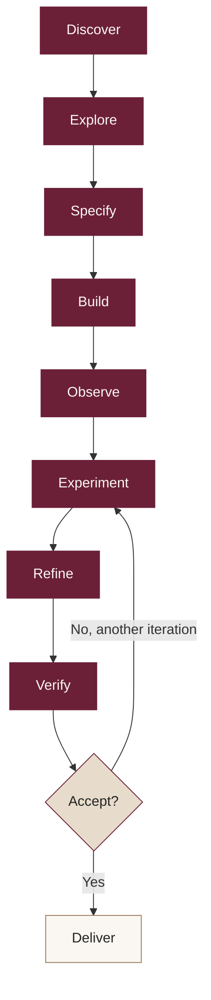

### <span style="color:#9A7B5F">4.3 Key UX principle</span>

> [!TIP]
> Kiro's chat is the primary interface. The companion workbench exists only for interactions that chat handles poorly: playing games, comparing variants, viewing trajectories and reviewing traces. It must not become a competing chat application or second AI IDE.

Proposed workbench routes:

| Screen | Required elements |
|---|---|
| Project overview | Game name, connection status, build status, latest approved design, launch button |
| Playtest | Actual game iframe, input instructions, reset, scenario selector, live event/metric panel |
| Compare | Two or three clearly identified playable variants, identical starting conditions, keyboard-focus control, reset, preference action |
| Evidence | Screenshot pairs, trajectory/telemetry charts, trace timeline, pass/fail/not tested states, reproducible scenario IDs |
| Decision history | Selected variant, rationale, linked requirement, baseline revision, apply status, revert instructions |

An A/B/C experiment must not change the underlying working tree until the user approves the selection. For parameter-only experiments, use temporary configuration overrides. For code-level alternatives, use user-approved isolated worktrees or snapshots in a later release. The MVP must refuse unsupported code-level variants rather than overwrite work.

## <span style="color:#B84D73">✅ 5. Functional requirements</span>

**Priority legend:** P0 = essential for hackathon MVP; P1 = desirable after P0 stability; P2 = later. All requirements below are proposals, not features already shipped.

The pie chart shows the priority mix across all 36 requirements in this section.

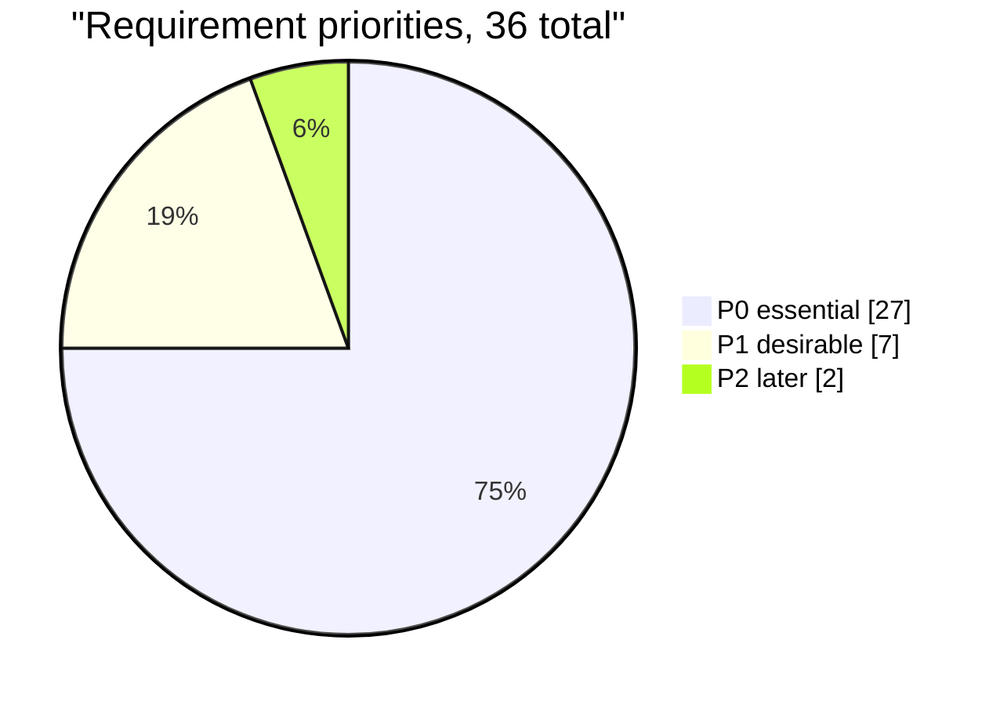

The bar chart shows how many requirements each area holds.

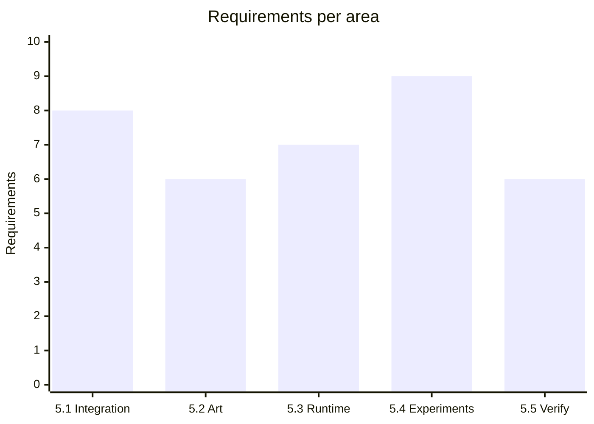

### <span style="color:#9A7B5F">5.1 Kiro-native integration and expert guidance</span>

| ID | Priority | Requirement and acceptance criterion |
|---|---|---|
| GD-001 | 🔴 <span style="color:#B84D73"><b>P0</b></span> | Install as a custom Power from a folder or public GitHub repository. On a clean supported Kiro IDE setup, installation registers the local MCP and game-related skills, and the agent can invoke `gd_project_status`. |
| GD-002 | 🔴 <span style="color:#B84D73"><b>P0</b></span> | No separate model credentials or AI provider SDK required. Complete both sample workflows through the user's ordinary Kiro session. Local deterministic tools run without contacting an LLM. |
| GD-003 | 🔴 <span style="color:#B84D73"><b>P0</b></span> | Detect a supported Phaser project, its engine version, package manager, configured launch command, adapter status and GameDNA state. Return an explicit unsupported result for other engines. |
| GD-004 | 🔴 <span style="color:#B84D73"><b>P0</b></span> | Provide focused skills for game design, movement, combat, visual direction, feedback, accessibility and playtesting. Each skill includes scope, recipes, trade-offs, measurement guidance and links to supporting sources. Only relevant material should be loaded. |
| GD-005 | 🔴 <span style="color:#B84D73"><b>P0</b></span> | Use Kiro Specs for requirements, design and tasks. Link each protected design decision to a stable requirement ID. Reopening the repository must recover accepted decisions without relying on prior chat history. |
| GD-006 | 🟠 <span style="color:#B26B00"><b>P1</b></span> | Add optional Kiro custom-agent configurations for design critique and independent QA. Use Kiro's built-in delegation; no custom LLM routing service. |
| GD-007 | 🔴 <span style="color:#B84D73"><b>P0</b></span> | Enforce the clean-slate policy in section 1.1. Review first-party source, skills, assets, demos and tests for provenance; maintain the originality and dependency inventories; fail the submission release gate if unapproved existing implementation is found. |
| GD-008 | 🔴 <span style="color:#B84D73"><b>P0</b></span> | Preserve real Kiro development evidence in root `.kiro/`, alongside accurate commit history and dated milestone notes. Record permitted dependencies, public documentation references and asset creation methods without storing account secrets. |

### <span style="color:#9A7B5F">5.2 Creative direction and asset production</span>

| ID | Priority | Requirement and acceptance criterion |
|---|---|---|
| GD-010 | 🔴 <span style="color:#B84D73"><b>P0</b></span> | Offer 3 original style packs: pixel-art adventure, geometric neon arcade and layered minimalist/cinematic. Each has original sample assets, palette, typography, scale, camera, motion and feedback conventions. Packs must visibly differ in more than color. |
| GD-011 | 🔴 <span style="color:#B84D73"><b>P0</b></span> | Produce original procedural PNG/SVG sprites, tiles, backgrounds, icons, particle definitions and simple synthesized sound effects from validated parameters. Given identical supported inputs, generator version and seed, generated asset bytes or canonical render hashes must match. |
| GD-012 | 🔴 <span style="color:#B84D73"><b>P0</b></span> | Validate assets for dimensions, required transparency, palette membership where applicable, sprite-sheet alignment and attribution. Return human-readable corrective diagnostics. |
| GD-013 | 🟠 <span style="color:#B26B00"><b>P1</b></span> | Generate supported sprite animation sheets and procedural level-decoration variations; preserve collision layout and asset licenses. |
| GD-014 | 🟠 <span style="color:#B26B00"><b>P1</b></span> | Post-hackathon only: support user-supplied licensed assets and brand/style tokens, with safe local import and traceable provenance. Do not import existing assets for the Kiroween entry. |
| GD-015 | 🔵 <span style="color:#6B7A86"><b>P2</b></span> | Support opt-in third-party image or audio providers using the user's separate authorized credentials. Never imply Kiro credits cover these calls. |

Procedural assets are not a universal replacement for professional art. Style packs should emphasize reproducible visual languages that code can render well. Kiro can author more complex SVG or Canvas assets directly, with the same validation and licensing rules.

### <span style="color:#9A7B5F">5.3 Runtime observability and playtesting</span>

| ID | Priority | Requirement and acceptance criterion |
|---|---|---|
| GD-020 | 🔴 <span style="color:#B84D73"><b>P0</b></span> | Launch an approved existing local dev command or attach to a configured local game URL; expose readiness, build/runtime errors and stop controls. Avoid arbitrary shell command execution through MCP. |
| GD-021 | 🔴 <span style="color:#B84D73"><b>P0</b></span> | Install or guide Kiro to create a small development-only Phaser adapter exposing sanitized state snapshots, tick count and typed events. Read position, velocity, health, level state and relevant settings where supported. |
| GD-022 | 🔴 <span style="color:#B84D73"><b>P0</b></span> | Capture actual game screenshots at specific observed ticks/checkpoints and return image content plus an artifact ID. Missing runtime or unsupported fields must be clearly reported. |
| GD-023 | 🔴 <span style="color:#B84D73"><b>P0</b></span> | Execute bounded scripted input scenarios with reset, seed, tick/time target and expected assertions. Record key transitions, game revision, runtime settings and first observed failure. |
| GD-024 | 🔴 <span style="color:#B84D73"><b>P0</b></span> | Export a replayable trace and compare two executions of supported scenarios. Distinguish exact state comparisons from tolerance-based comparisons. Unreproducible runs must be marked unstable. |
| GD-025 | 🟠 <span style="color:#B26B00"><b>P1</b></span> | Provide collision/debug overlays, camera bounds, input latency instrumentation and frame-time summaries. Metrics must include the measurement method and limitations. |
| GD-026 | 🟠 <span style="color:#B26B00"><b>P1</b></span> | For grid-based or explicitly modeled levels, analyze reachability using appropriate graph search. Do not claim proof of solvability for arbitrary physics-based levels. |

### <span style="color:#9A7B5F">5.4 Playable experiments and preference persistence — core differentiation</span>

| ID | Priority | Requirement and acceptance criterion |
|---|---|---|
| GD-030 | 🔴 <span style="color:#B84D73"><b>P0</b></span> | A subjective request produces a baseline and 2–3 concrete parameter alternatives, authored by Kiro using engine-specific knowledge. Each variant declares what changes, why, which constraints remain protected and which metrics will be compared. |
| GD-031 | 🔴 <span style="color:#B84D73"><b>P0</b></span> | Run actual variants of the same game using approved parameter overrides with identical initial scenario state, controls and viewport. Variants cannot silently change protected gameplay objectives. |
| GD-032 | 🔴 <span style="color:#B84D73"><b>P0</b></span> | Compare movement and action-feedback variants through at least two measurement families (movement trajectory and timing; combat feedback and cooldown behavior). Show raw units, baseline and uncertainty, not a universal “fun” number. |
| GD-033 | 🔴 <span style="color:#B84D73"><b>P0</b></span> | Record explicit user selection, optional rationale, scenario, parameter diff, baseline revision, evidence IDs and protected requirements. No automatic preference inference from time played. |
| GD-034 | 🔴 <span style="color:#B84D73"><b>P0</b></span> | Provide selected configuration diff to Kiro for application through normal source-edit tools. Verify that the baseline revision still matches; reject stale selections or require explicit rebase/revalidation. |
| GD-035 | 🔴 <span style="color:#B84D73"><b>P0</b></span> | After applying the selected variant, rerun protected checks and confirm effective parameters match the selected variant. A failed or missing required check prevents a verified status. |
| GD-036 | 🔴 <span style="color:#B84D73"><b>P0</b></span> | Preserve or restore baseline on request; never discard unrelated user changes. On rejection, keep the actual project untouched. |
| GD-037 | 🟠 <span style="color:#B26B00"><b>P1</b></span> | Compare art-direction and camera variants with actual screenshots and controlled gameplay previews. |
| GD-038 | 🔵 <span style="color:#6B7A86"><b>P2</b></span> | Support code-level alternatives in isolated, user-approved worktrees with reviewable diffs and explicit merge. |

### <span style="color:#9A7B5F">5.5 Verification and delivery</span>

| ID | Priority | Requirement and acceptance criterion |
|---|---|---|
| GD-040 | 🔴 <span style="color:#B84D73"><b>P0</b></span> | Generate or guide Kiro to write project-native unit/property tests using fast-check and a test runner. Every protected invariant has an executable check or a visible `not_tested` reason. |
| GD-041 | 🔴 <span style="color:#B84D73"><b>P0</b></span> | Report `passed`, `failed`, `not_tested`, `unsupported` or `unstable` per check; never convert tool failure into a quality pass. |
| GD-042 | 🔴 <span style="color:#B84D73"><b>P0</b></span> | Provide a bounded regression hook or explicit command that reruns relevant checks after changes; debounce and avoid recursive agent calls. Full browser runs are opt-in or task-boundary checks, not every keystroke. |
| GD-043 | 🔴 <span style="color:#B84D73"><b>P0</b></span> | Deliver a normal Phaser build and repository instructions. Disable/remove dev-only bridge in production; exported game works without MCP, Kiro or the workbench. |
| GD-044 | 🔴 <span style="color:#B84D73"><b>P0</b></span> | Export a local evidence report with revision, scenario, seed, results, supported metrics, approved decisions, known limitations and asset provenance. |
| GD-045 | 🟠 <span style="color:#B26B00"><b>P1</b></span> | Generate accessible control alternatives, reduced motion and visual feedback settings; verify each supported option through scenarios. |

## <span style="color:#B84D73">🧬 6. GameDNA design record</span>

This is a development artifact, not a replacement for the game engine or a parallel source-code system. Kiro Specs remain authoritative for approved functional requirements. The GameDNA record stores creative decisions, tuning constraints and evidence links; actual code remains the executable implementation. Conflicts are flagged for reconciliation, not silently resolved.

Suggested repository structure for an installed game project:

```text
my-game/
  .kiro/
    specs/game/
      requirements.md
      design.md
      tasks.md
    steering/game-development.md
    hooks/game-regression.json
  .gamedna/
    project.json
    decisions.json
    scenarios/
    experiments/
    evidence/
    assets-manifest.json
  src/
    game/
    dev/gamedna-adapter.ts
  tests/
  public/assets/
  package.json
```

Illustrative `project.json` (schema to be versioned and validated):

```json
{
  "schemaVersion": 1,
  "projectId": "gravity-shift",
  "engine": { "id": "phaser", "version": "resolved-from-lockfile" },
  "design": {
    "genre": "puzzle-platformer",
    "coreLoop": "Explore, reverse gravity, reach exit",
    "stylePack": "layered-minimalist",
    "experienceGoals": ["responsive", "readable", "forgiving"]
  },
  "constraints": [
    { "id": "MOVE-01", "requirementRef": "REQ-4", "statement": "A normal jump cannot be repeated in midair" },
    { "id": "WIN-01", "requirementRef": "REQ-8", "statement": "Reaching the exit with all keys ends the level" }
  ],
  "parameters": {
    "movement.maxSpeed": { "value": 240, "unit": "px/s", "min": 150, "max": 320 },
    "movement.jumpVelocity": { "value": 480, "unit": "px/s", "min": 300, "max": 650 },
    "movement.coyoteTime": { "value": 80, "unit": "ms", "min": 0, "max": 150 }
  }
}
```

Values above are illustrative, not recommended settings for every game. Adapter validates parameter allowlists and units; Kiro decides appropriate ranges based on the project.

A decision record must include `decisionId`, `requirementRefs`, `experimentId`, `baselineRevision`, `chosenVariant`, `parameterDiff`, `rationale`, `evidenceIds`, `status`, and timestamp. Statuses: `proposed → selected → applied → verified`; terminal alternatives are `rejected`, `stale`, `failed` or `reverted`. The user can reject a proposal at any time. Preferences are scoped to the project; no cross-project automatic training.

The state diagram below shows how a decision moves through its statuses. Each transition follows a requirement named beside it.

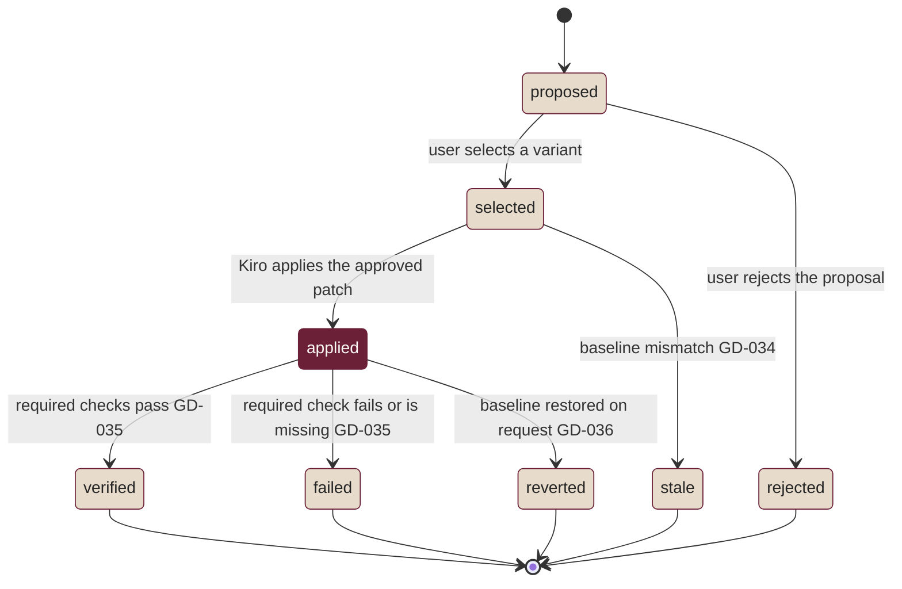

## <span style="color:#B84D73">🧱 7. Architecture</span>

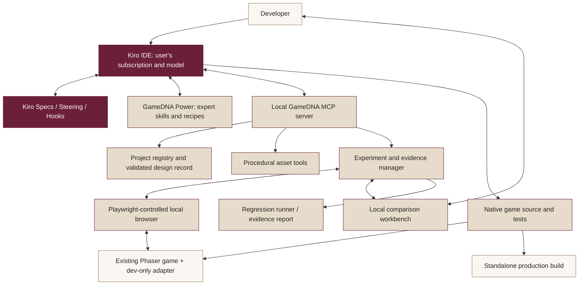

### <span style="color:#9A7B5F">7.1 Responsibilities</span>

| Component | Responsibilities | Explicit boundaries |
|---|---|---|
| Kiro | All AI reasoning, creative proposals, code edits, task execution, interpretation of evidence | GameDNA never invokes a private Kiro API or requests model credentials |
| Power package | Domain skill discovery and task-specific instruction | Does not replace the IDE or duplicate Kiro's spec system |
| MCP server | Validated local tool calls, run management, evidence IDs, artifact access | No generic arbitrary shell, unrestricted network fetch or cross-workspace file access |
| Phaser adapter | Development-only state snapshot, event capture, scenario reset, allowlisted parameter overrides | No physics/rendering replacement; no production dependency |
| Browser runner | Local navigation, input playback, screenshots, runtime error capture | Only authorized URLs/projects; bounded operations |
| Experiment manager | Variant isolation, seed/reset management, metrics, baseline hashes and selection persistence | Never chooses a subjective winner on the user's behalf |
| Workbench | Local playable previews, comparison, evidence and preference UI | No LLM chat or model API |
| Test runner | Deterministic checks, property tests, regression result aggregation | No guarantee of complete correctness or entertainment value |

### <span style="color:#9A7B5F">7.2 Technology stack</span>

- TypeScript + Node.js LTS compatible with pinned dependencies; pnpm/npm workspaces, Zod for schemas.
- MCP TypeScript SDK, stdio transport. Keep stdout reserved for protocol messages; logs go to stderr.
- Phaser, pinned to a stable version verified in the implementation spike. Prefer the known Phaser 3 API for MVP if the chosen release and docs are compatible; do not mix major-version examples.
- Playwright Chromium for real canvas rendering and input replay [R16]. Canvas objects are not necessarily accessible through DOM locators; use screenshots plus the explicit adapter, not DOM-only automation.
- Vite + React for the local workbench; minimal HTTP server bound to `127.0.0.1` with session authentication. Local static JSON or atomic file persistence; no database required for MVP.
- Vitest and fast-check for pure state, schema and model-based tests [R17]. FFmpeg is optional for later video capture; no video-generation service required.
- Procedural assets: deterministic SVG generation, Canvas/raster processing, seeded PRNG, original palette and procedural audio. Prefer dependencies with licenses compatible with distribution.

### <span style="color:#9A7B5F">7.3 Runtime adapter contract</span>

A small bridge written for supported Phaser projects exposes `reset(seed, scenario)`, `getSnapshot()`, `getEvents(cursor)`, `setExperimentParameters(allowlistedValues)` and, for controlled tests, `step(n)` only where the implementation can correctly coordinate the engine's loop. Normal browser playback remains available separately.

For MVP, use either an explicitly integrated fixed-step harness for the supported mechanics or timestamped scripted input with tolerances. A seed alone does not guarantee deterministic engine behavior. Record actual step mode, physics configuration, game version, viewport and browser version. A fixed-tick claim is allowed only after replay tests establish reproducibility on the supported stack.

The adapter is loaded only in development mode through a build-time flag; validate its absence in production output. Never expose a debug bridge on a public production game.

### <span style="color:#9A7B5F">7.4 Current Kiro packaging</span>

As of 24 November 2026, Kiro's current Power documentation specifies a `plugin.json` manifest, optional `skills/` directories with `SKILL.md` files, and `mcp.json` for integrations [R5–R7]. Use the documented modern format; do not rely on the older `POWER.md` format for the primary release.

Suggested hackathon monorepo:

```text
GameDNA/
  .kiro/                 # actual specs, hooks, steering used to build GameDNA
  power/
    plugin.json
    mcp.json
    skills/
      game-direction/SKILL.md
      game-feel/SKILL.md
      technical-art/SKILL.md
      playtesting/SKILL.md
      refinement/SKILL.md
  packages/
    core/                # schemas, decisions, evidence, experiment lifecycle
    mcp/                 # local stdio server and validated tools
    phaser-adapter/      # dev-only instrumentation and configuration
    assets/              # seeded generators and style packs
    starter/             # ORIGINAL lean skeleton, written during the hackathon (not an engine)
    workbench/           # local comparison application
  apps/
    gravity-shift/       # complete platformer application
    neon-survivor/       # complete top-down action application
  tests/
  docs/
    research.md
    benchmarks.md
    third-party-notices.md
    originality.md       # actual first-party provenance and development timeline
    dependency-inventory.md
    install.md
  LICENSE
  README.md
```

MVP install route: publish a versioned MCP package or provide a documented local build and configure the Power using the installed executable. Validate the fresh-machine installation without relying on an absolute path specific to the author's computer. Kiro's modern plugin manifest requires schema/name/version/description/author/keywords; actual configuration follows the current docs [R5]. Use keywords such as `game development`, `Phaser`, `game feel`, `playtest` and `sprite`, then verify activation on the supported IDE release.

## <span style="color:#B84D73">🔌 8. MCP interface contract</span>

All tools use strict input schemas, bounded arguments and structured results. Kiro performs reasoning outside the MCP server; tools return observations, artifacts and diagnostics. Prefix `gd_` avoids ambiguous names.

| Tool | Proposed inputs | Outputs / behavior | Priority |
|---|---|---|---|
| `gd_project_status` | project handle | engine/version, supported capability list, state, errors | 🔴 <span style="color:#B84D73"><b>P0</b></span> |
| `gd_get_style_pack` | pack ID, section | concise recipe, tokens, compatible generators, license | 🔴 <span style="color:#B84D73"><b>P0</b></span> |
| `gd_validate_design` | project handle, candidate record | validation errors, missing IDs, constraints | 🔴 <span style="color:#B84D73"><b>P0</b></span> |
| `gd_generate_asset` | asset type, style ID, seed, size, parameters | artifact ID, manifest, preview, hash | 🔴 <span style="color:#B84D73"><b>P0</b></span> |
| `gd_start_session` | project handle, approved command ID or local URL | session ID, readiness and diagnostics | 🔴 <span style="color:#B84D73"><b>P0</b></span> |
| `gd_stop_session` | session ID | shutdown status and cleanup report | 🔴 <span style="color:#B84D73"><b>P0</b></span> |
| `gd_observe` | session ID, snapshot fields, optional screenshot | actual state, frame image, event cursor | 🔴 <span style="color:#B84D73"><b>P0</b></span> |
| `gd_run_scenario` | session ID, scenario ID, seed, tick/time limit | trace, assertions, metrics, reproducibility status | 🔴 <span style="color:#B84D73"><b>P0</b></span> |
| `gd_create_experiment` | baseline revision, variants, scenario IDs, constraints | experiment ID, validated temporary override sets | 🔴 <span style="color:#B84D73"><b>P0</b></span> |
| `gd_compare_experiment` | experiment ID | evidence, metric deltas, local workbench URL | 🔴 <span style="color:#B84D73"><b>P0</b></span> |
| `gd_get_selection` | experiment ID | pending/selected/rejected; chosen variant and rationale | 🔴 <span style="color:#B84D73"><b>P0</b></span> |
| `gd_prepare_change` | experiment ID, expected baseline revision | approved parameter patch or stale-baseline error; Kiro applies it | 🔴 <span style="color:#B84D73"><b>P0</b></span> |
| `gd_verify` | project handle, check IDs, applied decision ID | per-check status, evidence and failure diagnostics | 🔴 <span style="color:#B84D73"><b>P0</b></span> |
| `gd_export_report` | project handle, selected run IDs | sanitized local report/artifact paths | 🔴 <span style="color:#B84D73"><b>P0</b></span> |
| `gd_analyze_level` | supported grid or graph model | reachable/unreachable nodes and path evidence | 🟠 <span style="color:#B26B00"><b>P1</b></span> |

The sequence below shows the tool calls for one refinement pass. Kiro drives the tools, and the developer makes the choice in the workbench.

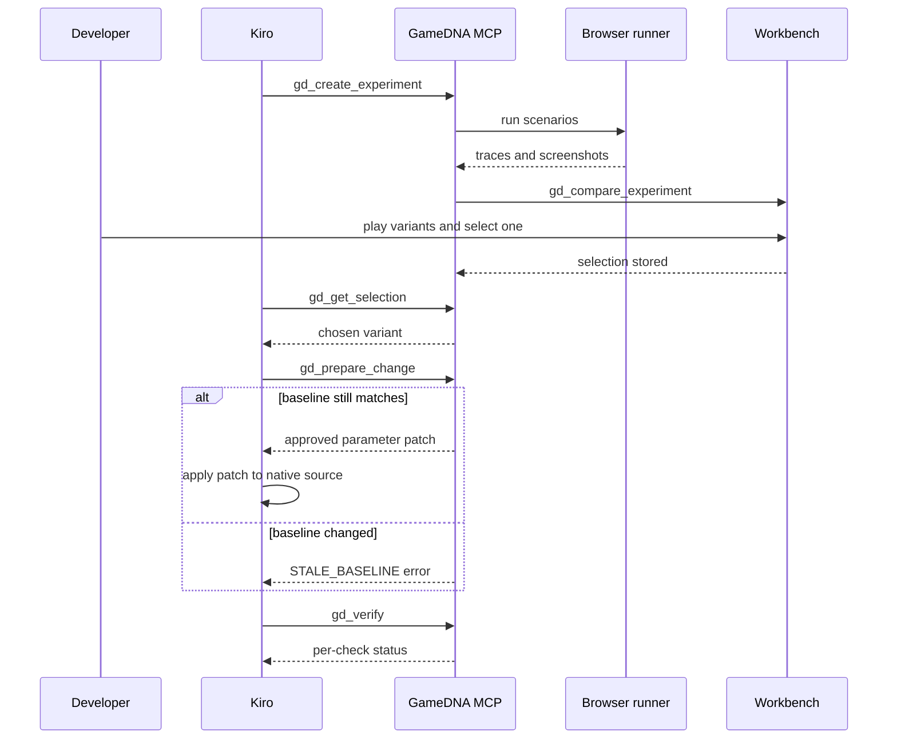

Long-running operations return job IDs where necessary and expose bounded status/cancel interfaces; avoid indefinite blocking. Use typed error codes: `UNSUPPORTED_ENGINE`, `ADAPTER_MISSING`, `INVALID_PARAMETER`, `SESSION_NOT_READY`, `STALE_BASELINE`, `TIMEOUT`, `PERMISSION_DENIED`, `UNSTABLE_REPLAY`, `ASSET_LICENSE_UNKNOWN`.

Example response to a failed scenario (illustrative):

```json
{
  "ok": true,
  "status": "failed",
  "scenarioId": "jump-buffer-edge",
  "revision": "git-revision-or-content-hash",
  "seed": 42,
  "checks": [
    { "id": "MOVE-01", "status": "failed", "observed": "second airborne jump", "tick": 112 }
  ],
  "traceId": "trace-001",
  "reproduction": { "scenarioId": "jump-buffer-edge", "seed": 42 },
  "limitations": ["Only the instrumented movement path was exercised"]
}
```

`ok` indicates successful execution of the tool, not a passed game check. Trace files are bounded and stored under the project; send summaries to Kiro and retrieve specific evidence on demand to control context/credit consumption.

## <span style="color:#B84D73">📚 9. Expert skill specification</span>

The skills should read like practical technical playbooks, not generic role prompts. Each contains when to activate, constraints, decision trees, measurable outcomes, newly authored and tested code recipes, anti-patterns, references and small original examples. Author all skills afresh during the hackathon; cite research and official docs without copying existing skills or implementations.

| Skill | Minimum content |
|---|---|
| Game direction | Core loop, player verbs, meaningful objectives, difficulty curve, progression, scope control, explicit concept trade-offs |
| Game feel | Acceleration/deceleration, jump arcs, coyote time, input buffering, hit stop, knockback, camera damping, responsiveness, comfort |
| Technical art | Palette hierarchy, silhouette readability, consistent scale, asset formats, sprite alignment, lighting, particles, UI legibility |
| Level design | Teach–test–twist progression, safe spawn, reachability, encounter spacing and feedback; distinguish heuristic and verified claims |
| Playtesting | Runtime inspection, scenario design, controlled input, evidence, regression invariants, accessibility and performance |
| Refinement | Establish baseline, propose bounded alternatives, isolate changes, obtain human choice, apply and validate, preserve decision provenance |

Example game-feel recipe: measure the baseline jump apex and airtime. For a simplified constant-gravity model, target height H and time-to-apex T imply gravity g = 2H/T² and initial speed v = 2H/T (magnitudes). This is an initial estimate, not a substitute for measurement in the actual engine with acceleration, damping, variable jump height and collision. Offer alternative target behaviors, compare them in the real game, then record the user's choice.

### <span style="color:#9A7B5F">9.1 Refinement policy</span>

The flowchart below applies the two-attempt limit from policy 6 to each refinement round.

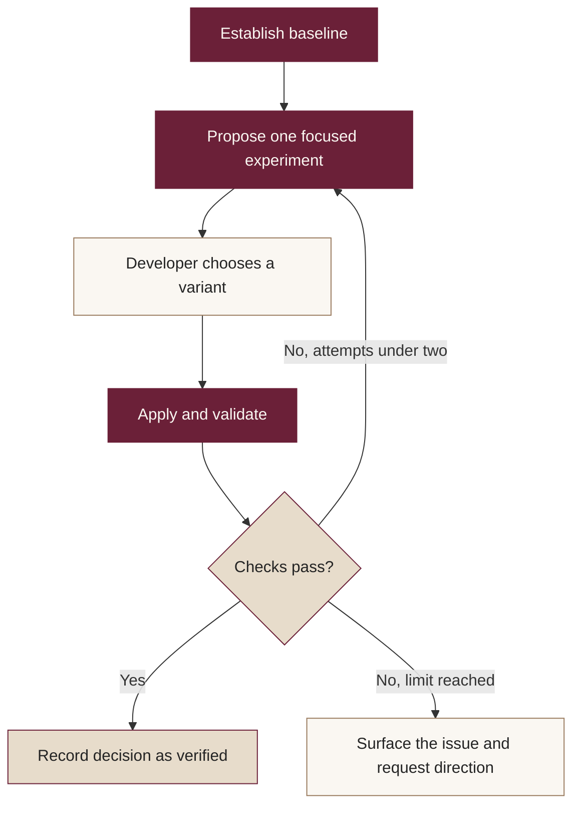

1. Prefer a single focused experiment over changing unrelated variables.
2. Do not equate more particle effects, shake or speed with better game feel.
3. Protect game rules, accessibility preferences and the user's approved creative direction.
4. Make alternative trade-offs understandable; avoid unsupported rankings of fun.
5. Use measured observations for technical claims; use human preferences for subjective quality.
6. Limit automated refinement to two attempts by default, then surface the remaining issue and request direction. Never silently spend unlimited Kiro credits.

## <span style="color:#B84D73">📏 10. Metrics and acceptance criteria</span>

### <span style="color:#9A7B5F">10.1 Game-quality measurement</span>

| Metric | Definition | Interpretation |
|---|---|---|
| Time to apex | Time from observed jump initiation to maximum vertical displacement | Movement tuning, not a universal target |
| Jump height / airtime | Peak displacement in px; duration before landing in ms | Compare variants under identical scenario conditions |
| Input-to-state delay | Observed game ticks or ms between injected input and corresponding state change | Runtime response proxy; not end-to-end hardware latency |
| Cooldown consistency | Observed interval between valid action events vs configured cooldown | Objective mechanic invariant |
| Hit feedback timing | Time from registered hit to configured feedback events | Verify event coordination, not aesthetic merit |
| Frame time | Measured browser/game frame intervals; report median and p95 in a stated environment | Performance indicator; not GPU presentation latency |
| Scenario assertions | Passed/failed/not tested/unstable checks by requirement | Coverage of defined scenarios, not proof of all behavior |
| User preference | Blind selection or explicit preference after playing comparable variants | Subjective outcome; report sample and protocol |

### <span style="color:#9A7B5F">10.2 MVP release gates (targets, not measured results)</span>

- Clean install: a new supported local setup can activate GameDNA and launch the first sample with a documented sequence; target under 10 minutes after prerequisites installed, verify on at least two clean environments if available.
- Two complete games, newly authored during the submission period, run from independent app folders and production builds without the dev bridge or MCP.
- Originality gate: the fresh repository, first-party source, original assets, both games and the newly written shared skeleton pass the provenance review; standard dependencies are documented and licensed. No existing project code is included.
- At least 3 visually distinct style packs, with real preview outputs and reproducible supported assets.
- Each demo supports a baseline and at least two actual alternatives; user selection is persisted and applied to native project code/configuration by Kiro.
- At least one demonstrable detected regression per game and an evidence-backed repair. Use seeded intentionally introduced faults, clearly labeled as such.
- At least 5 repeated identical-seed runs per flagship scenario: compare exact fields where justified and measured tolerances elsewhere; flag instability rather than hiding it.
- At least 20 automated core tests covering validation, asset determinism, selection lifecycle, stale baseline handling, bounded scenarios, path restrictions and failure reporting.
- Target p95 under 250 ms for simple warmed local status/validation calls on a documented machine; exclude game launch, screenshots and rendering. Measure rather than promise.
- Workbench: all essential interactions keyboard accessible, clear keyboard focus, readable text, explicit comparison reset, non-color-only status indicators.

### <span style="color:#9A7B5F">10.3 Controlled comparison against ordinary Kiro</span>

Use the same Kiro model/version, engine version, hardware, starter conditions, game brief and time/credit budget. Compare ordinary Kiro against Kiro + GameDNA; record all prompts, human interventions and failures. Randomize run order and repeat if resources permit. Both arms start with eligible, newly authored baseline conditions. No pre-existing code, assets or templates may be used in either arm. Document any original GameDNA capabilities available only to the intervention arm.

Measure: elapsed time to playable build, time to approved refinement, manual interventions, recorded Kiro credits (when available), regression-check results and blind preference. Use a small pilot with 5–10 consenting testers if feasible. Ask about visual coherence, control responsiveness, feedback clarity and overall preference separately. Randomize which version appears first. Report sample sizes, medians, ranges and limitations. A small hackathon pilot is not population-level proof; negative results are valid.

Suggested hypothesis: GameDNA reduces manual refinement time by 30% and is preferred by at least 70% of pilot testers, while preserving protected behavior. These are aspirational evaluation hypotheses, not marketing claims or established outcomes. If recorded credit usage is unavailable, report it as unavailable rather than reconstructing it from token estimates.

## <span style="color:#B84D73">🧩 11. Two hackathon applications</span>

Both must be authored from scratch with Kiro within the submission window, and use the same newly authored lean reusable GameDNA starter and development workflow, not merely share generic libraries. Each has a distinct core loop and independent source/build folder. They should be small, finished vertical slices rather than large incomplete games.

### <span style="color:#9A7B5F">App A: Gravity Shift</span>

- Genre: atmospheric 2D puzzle platformer, layered minimalist visual direction.
- Core loop: traverse obstacles, reverse gravity, collect keys and reach exit.
- Scope: title screen, tutorial prompt, 2–3 short levels, win/retry state, pause, reduced-motion setting if feasible.
- Flagship experiment: snappy versus forgiving versus floaty movement (jump trajectory, acceleration, input buffer).
- Protected rules: no unauthorized midair jump; no input while dead; restart resets level; exit requires keys.
- Seeded defect: overlapping movement conditions allow an unintended second jump. Capture the exact input replay, fix via Kiro, rerun the protected rule.

### <span style="color:#9A7B5F">App B: Neon Survivor</span>

- Genre: neon geometric top-down survival arcade.
- Core loop: move, evade and attack enemies, collect score, survive escalating waves.
- Scope: title, one polished arena, several enemy waves, health/score, restart, victory/game-over.
- Flagship experiment: subtle versus punchy combat feedback (hit stop, knockback, flash, shake with reduced-motion option where feasible).
- Protected rules: cooldown cannot be bypassed; dead enemies score once; health cannot become negative; restart clears run state.
- Seeded defect: duplicate damage event creates duplicate score. Show replay evidence, Kiro fix, targeted regression result.

Create all demo art, animations, sounds and levels specifically for GameDNA during the submission window. Do not import asset packs or copy existing game characters, art or trademarked presentation. Use standard licensed tool/font dependencies only as needed and document their notices. Both applications should have functioning public builds for judges; provide a separate public read-only workbench/demo with captured, clearly labeled real experiment data if the live local Kiro workflow cannot be hosted. The real integration must be shown in the video and reproducible locally.

## <span style="color:#B84D73">🔒 12. Security, privacy and reliability</span>

- All tools default to the explicitly registered project root. Canonicalize paths, prevent traversal and symlink escapes, and separate artifact reads/writes from the rest of the machine.
- No generic `exec` tool. Start only a configured, user-authorized package script or attach to an approved local URL. Use argument arrays, timeouts and child-process cleanup.
- Bind the workbench to loopback by default. Require a per-session token, origin checks, CSRF protection for state-changing actions and strict allowed game origins. Do not permit arbitrary remote URLs or pages with private credentials. Treat all page text, assets and logs as untrusted data, never as agent instructions.
- Sanitize runtime state, logs, screenshots and evidence; do not include keys, cookies, account identifiers or unrelated filesystem contents. User explicitly chooses what to export/share. No telemetry by default.
- Limit artifact count, screenshot dimensions, variant count, runtime duration, asset size, disk use and concurrent jobs. Cancel/cleanup must work on crash and timeout.
- Preserve source changes through normal Kiro permission/checkpoint and Git flows. Detect stale baselines and dirty trees; do not force checkout, reset or overwrite unrelated files.
- Validate all schemas and commands. Pin dependencies, audit licenses, document third-party components and ensure final game artifacts do not include development-only endpoints.
- Avoid unsafe effects: allow reduced motion for strong shake/flashing, avoid excessive rapid flashes, keep important state changes visible through more than color when possible.

## <span style="color:#B84D73">📅 13. Delivery plan: 24 November – 4 December 2026</span>

This is an aggressive, single-developer-oriented scope. Prioritize integration and evidence before a broad style library. Cut P1/P2 if any P0 gate is at risk.

| Date (IST) | Deliverable | Exit criterion |
|---|---|---|
| Nov 24 | Clean-slate repository and integration spike | Fresh repository and original Kiro specs committed; Kiro installs newly authored Power, invokes new MCP, launches Phaser and reads real state |
| Nov 25 | Core schemas and starter | Design record, approved decisions, adapter, project detection, tests |
| Nov 26 | Runtime observation | Screenshots, bounded input scenario, trace, reset and failure handling |
| Nov 27 | Experiment engine | Same-game parameter overrides, comparison, selection and stale-baseline handling |
| Nov 28 | Workbench | Actual playable A/B/C with keyboard focus, reset and evidence display |
| Nov 29 | Style packs and assets | Three distinct, original style previews and deterministic generators |
| Nov 30 | Gravity Shift | Complete short playable game, movement experiment, verified regression |
| Dec 1 | Neon Survivor | Complete short playable game, combat experiment, verified regression |
| Dec 2 | Hardening and pilot | Clean install, production bridge exclusion, targeted tests, comparison data, originality and license audit |
| Dec 3 | Packaging and presentation | Public game demos, README, reproducible evidence, demo video |
| Dec 4 | Release and submission | Freeze tested revision, check all links/eligibility, submit before official cutoff |

The Gantt chart below turns the delivery table into a timeline. Each bar is one day of work.

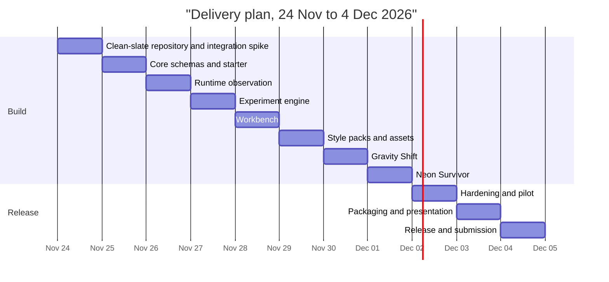

The flowchart below shows the day-one checks and the fallback for each failure.

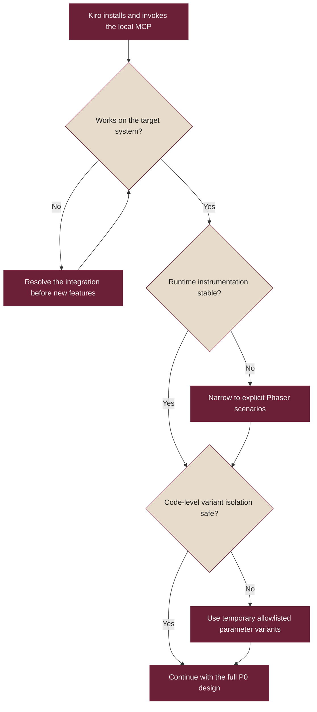

> [!WARNING]
> **Day-one kill condition:** if Kiro cannot install/invoke the real local MCP on the target system, resolve the integration before building additional features. If runtime instrumentation is unstable, narrow to explicit supported Phaser scenarios. If code-level variant isolation is unsafe, stick to temporary allowlisted parameter variants; this is already the P0 design.

## <span style="color:#B84D73">🎃 14. Kiroween 2026 submission strategy</span>

Official rules [R18], checked on November 24, 2026 (rules updated November 16), require a newly created working project using Kiro, disclosure of incorporated nonstandard pre-existing work, a functional application URL, public GitHub source with an open-source license, committed root `.kiro/`, and a public YouTube demonstration under three minutes. Skeleton Crew requires two distinct applications in separate repository folders, built from the same flexible skeleton. The exact submission window is October 30, 2026, 9:00 AM PDT to December 4, 2026, 2:00 PM PST (October 30, 9:30 PM IST to December 5, 3:30 AM IST). Set an earlier internal deadline and reconfirm the rules before submitting.

### <span style="color:#9A7B5F">14.0 Originality and provenance release gate</span>

GameDNA voluntarily exceeds the minimum new-project rule by forbidding imported pre-existing first-party or third-party project implementations, even when disclosure would otherwise permit reuse. Section 1.1 governs all submitted work. Standard dependencies are not represented as GameDNA inventions.

Before submission, the entrant must review and maintain:

| Artifact | Evidence required |
|---|---|
| `docs/originality.md` | Actual project creation date, first commit, development milestones, original component list, authorship statement, deviations/issues resolved |
| `docs/dependency-inventory.md` | Standard packages, pinned versions, purpose, license and source links; generated lockfile checked in |
| `docs/third-party-notices.md` | Required dependency notices and licenses; disclose any permitted externally sourced materials accurately |
| `.gamedna/assets-manifest.json` or per-app manifests | Original asset generator/source, seed where applicable, creation/revision record, rights information |
| Root `.kiro/` and Git history | Authentic Kiro specifications, hooks, steering, incremental implementation and test evidence |
| `apps/gravity-shift/` and `apps/neon-survivor/` | Independent builds, source and original assets, both using the new shared starter |

Review the actual history and code, not merely the existence of these files. If the zero-reuse project policy cannot be substantiated, do not falsely assert compliance; remove the questionable material or obtain organizer guidance before proceeding. Never erase attribution or existing history to conceal reuse.

The flowchart below shows the gate. The entrant attests to originality only after every provenance check passes.

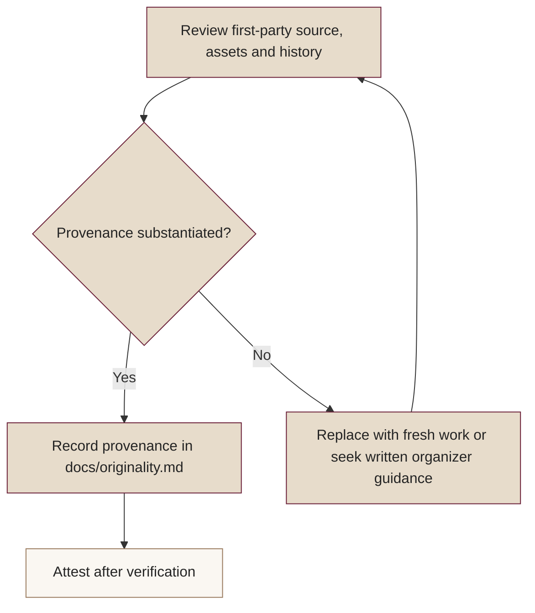

The final Devpost disclosure should accurately state, **only after verification**, that the first-party implementation and both demos were created during the competition window, identify the standard frameworks/libraries used, and explain the original GameDNA contribution. The rules permit standard dependencies; there is no need to build Phaser or the MCP SDK from scratch.

### <span style="color:#9A7B5F">14.1 Judging alignment</span>

| Official criterion | GameDNA evidence to provide |
|---|---|
| Potential impact — 20% | Common developer workflow, simple installation, independently playable games, real pilot observations |
| Technological implementation — 20% | Actual Kiro Specs, steering, hooks, custom Power, MCP tools, property tests and measured refinement workflow |
| Design — 20% | Polished games, intuitive comparison workbench and clear evidence, minimal setup |
| Innovation/idea — 20% | Same-game experiments with explicit preference and requirement-linked regression, compared against prior art |
| Presentation — 20% | Real end-to-end Kiro workflow, visually obvious alternatives, a reproducible failure and two distinct outputs |

Do not claim that GameDNA can only work with Kiro at a protocol level. Its strategic value is the intentional integration with Kiro's native spec-driven workflow, Powers, permissions and hooks. Make Kiro adoption attractive rather than manufacturing exclusivity.

### <span style="color:#9A7B5F">14.2 Under-three-minute demonstration</span>

| Time | Content |
|---|---|
| 0:00–0:18 | Show a plain functional prototype; explain why coding a game is not the same as making it feel good |
| 0:18–0:40 | Install/activate GameDNA in real Kiro; ask it to refine the platformer |
| 0:40–1:20 | Play actual A/B/C movement variants, compare trajectories, choose one |
| 1:20–1:50 | Show Kiro apply the chosen change; replay a seeded regression and verify the fix |
| 1:50–2:15 | Show the second game and different combat-feedback refinement using the same foundation |
| 2:15–2:40 | Show recorded pilot/benchmark results and transparent limitations; show project source and spec evidence |
| 2:40–2:55 | Show standalone playable builds and public install instructions; conclude with the product promise |

### <span style="color:#9A7B5F">14.3 Definition of done for submission</span>

- [ ] Fresh GameDNA repository and all submitted first-party implementation, skills, assets, tests and demo games created within the competition period.
- [ ] No copied, forked, adapted, ported or imported existing project implementations or templates; originality audit completed and actual findings documented.
- [ ] Standard third-party dependencies pinned, authorized, inventoried and attributed; any external materials disclosed truthfully.
- [ ] Originality, license and asset provenance records match the actual code and artifacts.
- [ ] Actual Kiro use is documented with committed root `.kiro/` specs, steering and hooks; no secrets committed.
- [ ] Installable, versioned Power/MCP package and documented target environment.
- [ ] Two distinct runnable games in separate folders; shared lean starter is explicit and documented.
- [ ] Public functional demo URLs and reproducible local install instructions.
- [ ] Public GitHub repository with visible open-source license, all necessary source and permitted assets.
- [ ] Public YouTube demo under three minutes; all third-party material authorized.
- [ ] Evidence report and benchmark methodology with real results, no invented claims.
- [ ] Devpost category and any eligible student/blog bonus details completed.

## <span style="color:#B84D73">🚨 15. Risks and mitigation</span>

| Risk | Severity | Mitigation |
|---|---|---|
| Inadvertent reuse or unclear artifact provenance | High | New empty repository, no imported project code/templates/assets, original Kiro implementation, dependency and asset inventory, review before release |
| Product resembles existing game MCP toolkits | High | Lead with same-project controlled experiments, durable decisions and regression evidence; demonstrate actual improvement |
| Browser/game timing is nondeterministic | High | Use explicit supported harness, repeated seeds, tolerances and instability labels |
| Kiro does not follow all skill instructions | High | Keep skills targeted; validate tool contracts; gate verified status on independent checks rather than model assurances |
| Low-quality generated art | High | Focus on three code-friendly styles with hand-designed original samples and consistent primitives |
| Variant modifies unrelated behavior | High | Parameter allowlists, baseline hashes, protected requirements, revalidation and no silent commits |
| Excessive Kiro credit usage | Medium | On-demand context, concise structured observations, local deterministic tools, bounded iterations, no hidden model calls |
| Workbench security | High | Loopback, session token, origin checks, strict paths, bounded commands, development-only bridge |
| Scope/time overrun | High | One engine, two short games, no multiplayer/3D/cloud, freeze core functionality before polish |
| No proven market superiority | High | Report actual controlled pilot results; do not make unsupported claims |

## <span style="color:#B84D73">🚀 16. Post-hackathon roadmap</span>

- **v0.2:** More robust visual comparison, controlled camera/level experiments, richer accessibility checks, original animation and audio libraries.
- **v0.3:** Godot adapter through documented editor integration, capability discovery, safe code-level variants using Git worktrees; evaluate whether portability justifies complexity.
- **v1.0:** Reusable project-specific design profiles, extension SDK for skill/style/engine adapters, team-readable evidence, optional user-authorized asset providers and publishing integrations.

Do not add a second AI agent product or inference subscription as a default roadmap item. Preserve the Kiro-native product boundary.

## <span style="color:#B84D73">🔗 17. Research references</span>

Accessed 24 November 2026 unless otherwise noted. The following support the product's factual background and technical choices; all GameDNA requirements, rankings, schedules and numerical targets are proposed, not independently measured.

- [R1] *Designing Game Feel: A Survey*, IEEE Transactions on Games, DOI: [10.1109/TG.2021.3072241](https://doi.org/10.1109/TG.2021.3072241). [Preprint](https://arxiv.org/abs/2011.09201). Research grounding for tuning, feedback and player support.
- [R2] Hicks, Dickinson, Holopainen and Gerling, *Good Game Feel: An Empirically Grounded Framework for Juicy Design*, DiGRA 2018, [paper record](https://dl.digra.org/index.php/dl/article/view/936/).
- [R3] Kiro, [Specs documentation](https://kiro.dev/docs/specs/).
- [R4] Kiro, [Correctness and property-based testing](https://kiro.dev/docs/specs/correctness/).
- [R5] Kiro, [Create Powers](https://kiro.dev/docs/powers/create/) — current plugin manifest, skills and MCP packaging.
- [R6] Kiro, [Powers overview](https://kiro.dev/docs/powers/) and [installation](https://kiro.dev/docs/powers/installation/).
- [R7] Kiro, [How Kiro works](https://kiro.dev/docs/how-kiro-works/), [Hook triggers](https://kiro.dev/docs/hooks/types/) and [MCP overview](https://kiro.dev/mcp/).
- [R8] Kiro, [FAQ](https://kiro.dev/faq/), [billing questions](https://kiro.dev/docs/billing/related-questions/) and [ACP integrations](https://kiro.dev/docs/acp/).
- [R9] AWS for Games, [AI-assisted game production: From static concept to interactive prototype](https://aws.amazon.com/blogs/gametech/ai-assisted-game-production-from-static-concept-to-interactive-prototype/).
- [R10] [Kiro Multi-Agent Game Studio](https://github.com/hoycdanny/kiro-multi-agent-game-studio), public project documentation.
- [R11] [Godot Forge MCP](https://github.com/Tann2019/godot-mcp-server), public project documentation.
- [R12] [Godot MCP Toolkit](https://store.godotengine.org/asset/npgamedev/godot-mcp-toolkit/), Godot Asset Store.
- [R13] [Ziva AI Agent for Godot](https://store.godotengine.org/asset/ziva/ziva/), Godot Asset Store.
- [R14] [Game Feel Lab](https://github.com/Persids-py/game-feel-lab), public project documentation.
- [R15] Phaser, [official framework docs](https://www.phaser.io/oss/docs) and [Arcade Physics guide](https://phaser.io/oss/docs/phaser/concepts/physics/arcade).
- [R16] Playwright, [screenshots](https://playwright.dev/docs/screenshots).
- [R17] fast-check, [property-based testing](https://fast-check.dev/docs/introduction/what-is-property-based-testing/) and [model-based testing](https://fast-check.dev/docs/advanced/model-based-testing/).
- [R18] Devpost, [Kiroween 2026 official rules](https://kiroween.devpost.com/rules) and [competition page](https://kiroween.devpost.com/).

---

> [!NOTE]
> **Product north star:** GameDNA succeeds when a developer can remain inside Kiro, describe the experience they want, play real alternatives, approve a creative decision, and obtain a refined game whose behavior is supported by evidence — without becoming a game-engine expert or paying for another AI coding service.
