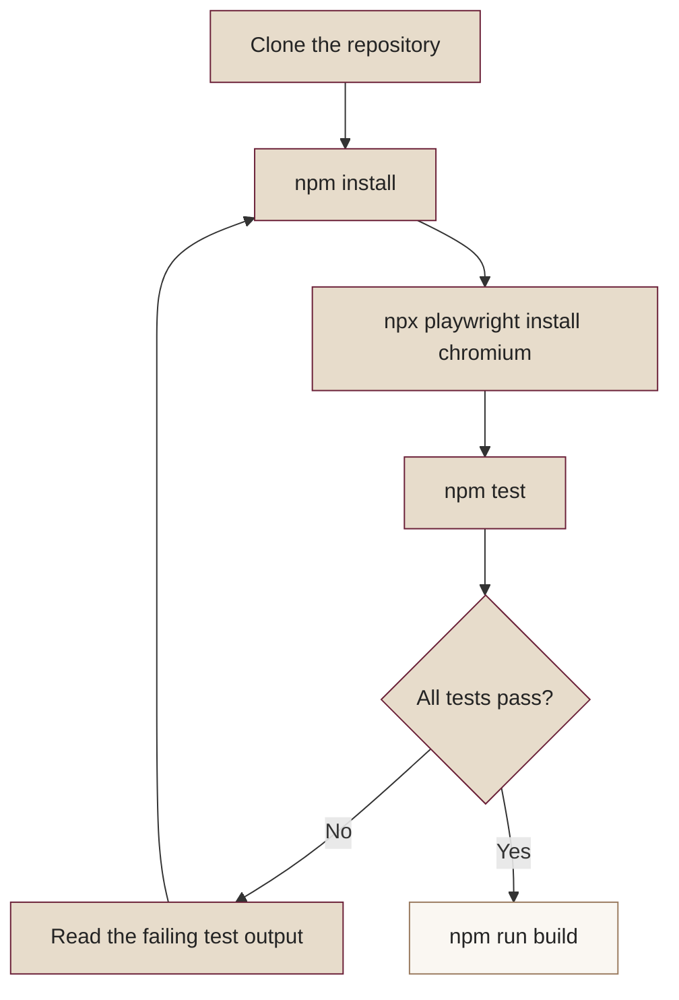
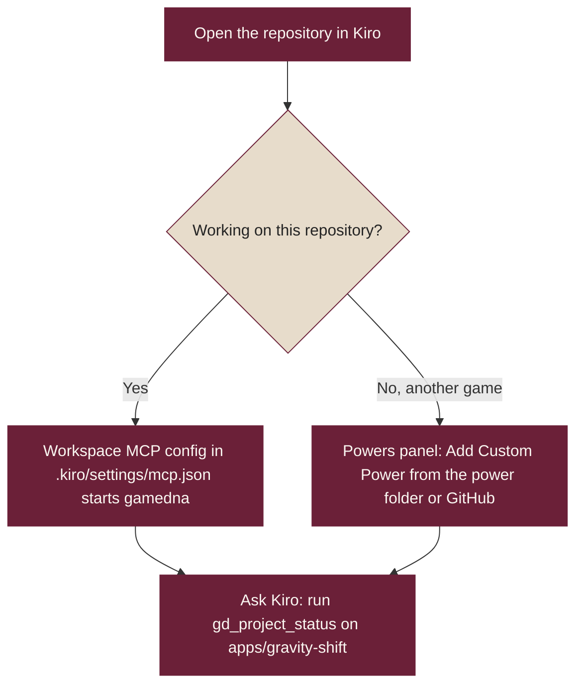

# <span style="color:#B84D73">🧬 GameDNA installation guide</span>

This guide installs GameDNA, connects it to Kiro and runs the two demo games.

Reading key for this document:

| Symbol | Meaning |
|---|---|
| 🧰 📦 ⚡ 🕹️ 🛠️ | Section icons, defined in `docs/rules.md` section 2 |
| Flowchart | Steps and decisions, read top to bottom |

## <span style="color:#B84D73">🧰 1. Prerequisites</span>

| Tool | Version | Check |
|---|---|---|
| Node.js | 22.12 or later (LTS) | `node --version` |
| npm | 10 or later | `npm --version` |
| Git | any recent | `git --version` |
| Kiro IDE | current release with Powers | Powers panel is visible |
| Chromium for Playwright | installed by step 2 | `npx playwright --version` |

GameDNA needs no API key, model account or cloud service beyond your normal Kiro sign-in.

## <span style="color:#B84D73">📦 2. Install and build</span>

The flowchart below shows the install steps from this section in order.



```bash
git clone https://github.com/bala2006/game-dna.git
cd game-dna
npm install
npx playwright install chromium
npm test
npm run build
```

Optional: `npm run test:e2e` runs the browser end-to-end tests after `npm run build`.

`npm run build` builds the workbench, bundles the MCP server into `power/server/gamedna-mcp.mjs`, builds both games and checks that the development bridge is absent from each production build.

## <span style="color:#B84D73">⚡ 3. Activate the Power in Kiro</span>

The flowchart below shows the two ways to connect GameDNA, as described in this section.



- **This repository.** `.kiro/settings/mcp.json` already registers the `gamedna` server with `node power/server/gamedna-mcp.mjs`. Open the folder in Kiro and the server starts.
- **Your own game.** In Kiro, open the Powers panel, choose **Add Custom Power**, then **Import power from a folder** and select `power/`, or **Import power from GitHub** with the repository URL. The manifest is `power/plugin.json`; the server is declared in `power/mcp.json`.
- **Workspace root.** The server resolves project paths against `GAMEDNA_WORKSPACE`, then the first MCP root Kiro provides, then its working directory. Set `GAMEDNA_WORKSPACE` in the server `env` if Kiro starts it from a different folder.

Ask Kiro "Use GameDNA to check the status of apps/gravity-shift". A working install returns the engine version `3.90.0`, the constraints and the scenario list.

## <span style="color:#B84D73">🕹️ 4. Run the demo games</span>

| Game | Dev server | Production build | Controls |
|---|---|---|---|
| Gravity Shift | `npm run dev -w gravity-shift` on port 5173 | `apps/gravity-shift/dist` | Arrows or A/D move, Space jumps, Shift or G reverses gravity, R restarts, P pauses, V toggles reduced motion, M mutes |
| Neon Survivor | `npm run dev -w neon-survivor` on port 5174 | `apps/neon-survivor/dist` | Arrows or WASD move, Space or J pulse-attacks, R restarts, P pauses, V toggles reduced motion, M mutes |

Each `dist/` folder is a static site. Serve it with any static host, for example `npm run preview -w gravity-shift`. Production builds do not contain the GameDNA bridge and do not need Kiro, the MCP server or the workbench.

## <span style="color:#B84D73">🛠️ 5. Troubleshooting</span>

| Symptom | Cause | Fix |
|---|---|---|
| `npm install` fails with `Cannot read properties of null (reading 'edgesOut')` | npm peer resolution bug with optional Vitest peers | The repository `.npmrc` sets `legacy-peer-deps=true`. Keep that file. |
| `SESSION_NOT_READY: Playwright is not installed` | Chromium or Playwright missing in the game project | `npm i -D playwright@1.65.1` in the game, then `npx playwright install chromium`. Headless runs work without it. |
| `ADAPTER_MISSING` after a session starts | The page is a production build or the bridge is not wired | Use the dev command and follow `power/skills/playtesting/SKILL.md` step 2. |
| `PERMISSION_DENIED: outside the project root` | `projectPath` points outside the workspace | Use a path relative to the workspace root, or set `GAMEDNA_WORKSPACE`. |
| Workbench shows "assets are not built" | The workbench was not bundled | `npm run build:workbench && npm run build:power`. |
| Linux Chromium fails to start | Missing system libraries | `npx playwright install-deps chromium` (needs administrator rights). |
