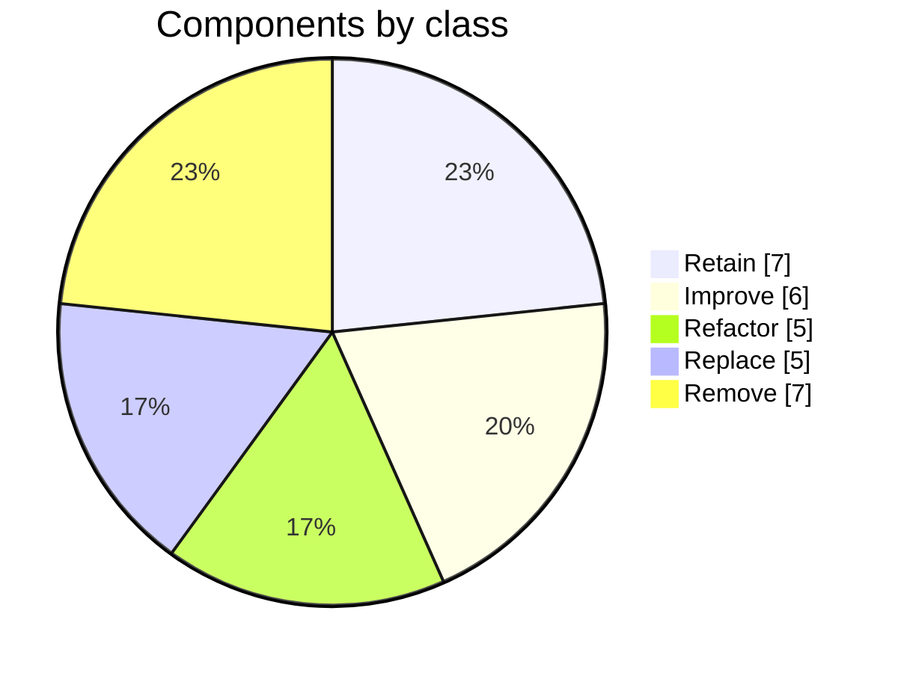
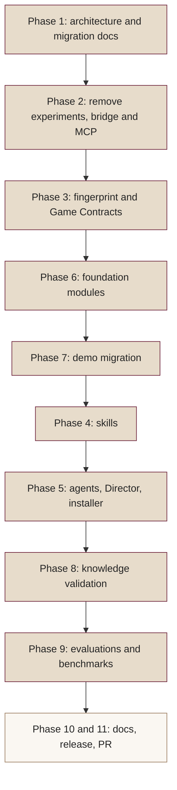

# 🧬 GameDNA 2.0 migration strategy

This document records how GameDNA 1.x was classified before any implementation code changed, the order of the migration and where it deviates from the specification. The target design is in `docs/ARCHITECTURE.md`.

Reading key:

| Symbol | Meaning |
|---|---|
| 🔎 | Investigation and baseline |
| 🔀 | Component classification |
| 📅 | Phase order |
| 🚧 | Deviations and limitations |

## 🔎 1. Baseline

Measured on `main` at commit `5497d28` before the branch was created, on Node 22.23.4:

| Check | Result |
|---|---|
| `npm ci` | 266 packages installed |
| `npm run typecheck` | Passed |
| `npm run check:docs` | 7 files, 0 problems |
| `npx vitest --run` | 16 files, 232 tests passed |
| `npm run build` | Workbench, Power bundle and four games built; bridge check passed; tree clean afterwards |
| `npm run test:e2e` | Not run at baseline: no Chromium installed in the sandbox at that point |

The repository was investigated by focused sub-agents: one traced the MCP, experiment and bridge dependencies, one mapped the Kit, starter, assets, apps and skills, one read the official Kiro documentation, and one studied the two reference repositories and the Kiroween rules.

## 🔀 2. Component classification

### 2.1 Packages

| Component | Class | Reason |
|---|---|---|
| `packages/kit` | Improve | Working, tested 3D foundation. Gains collision, controllers, vehicle handling, AI, navigation, events, saves, inventory, level generation, pooling, feedback, contracts and disposal. |
| `packages/starter` | Refactor | The fixed-step base and scene glue stay. The bridge-only `controlled` flag and dev hooks go. |
| `packages/assets` | Retain | Deterministic generators used by the Phaser games. Only its MCP consumer disappears. |
| `packages/core` | Refactor | Scenario runner, assertions, traces, metrics, PRNG re-export, errors and Node file helpers stay. Experiments, decisions, design validation, reports and revisions go. |
| `packages/mcp` | Remove | Own MCP server, browser sessions, observation pipeline, experiments, verification orchestration. Kiro does this natively. |
| `packages/workbench` | Remove | Comparison UI served only by the MCP server. |
| `packages/phaser-adapter` | Remove | The `window.__GAMEDNA__` bridge existed only for MCP sessions and workbench previews. Headless tests never used it. |

### 2.2 Applications

| Component | Class | Reason |
|---|---|---|
| `apps/gravity-shift` | Refactor | Drop the dev bridge. Move tile collision and platformer movement onto Kit modules with the same behavior. |
| `apps/neon-survivor` | Refactor | Drop the dev bridge. Use Kit steering, state machine, pooling and feedback timers. |
| `apps/ridgeline-racer` | Improve | Use Kit vehicle handling and path index; add contracts. |
| `apps/trail-walk` | Improve | Use Kit collision and the ground controller; add contracts. |
| `.gamedna/decisions.json`, `evidence/`, `experiments/`, `reports/` | Remove | Experiment records. |
| `.gamedna/scenarios/`, `assets-manifest.json` | Retain | Scenario tests and asset provenance. |
| `.gamedna/project.json` | Refactor | Keeps parameters and metrics used by tests; loses harness and command fields used only by MCP. |

### 2.3 Power, scripts and configuration

| Component | Class | Reason |
|---|---|---|
| `power/skills` | Replace | 20 skills with overlapping ownership become 25 skills with one owner and topic list each, portable guidance in the body and engine detail in references. |
| `power/server`, `power/mcp.json` | Remove | Bundled MCP server and workbench. |
| `power/plugin.json` | Improve | Describes the skills-only Power. |
| `power/kit` | Retain | Generated copy of the Kit for games outside this repository. |
| `scripts/build-power.mjs` | Replace | Becomes a Kit copy step only. |
| `scripts/bench-mcp.mjs`, `scripts/check-prod-bridge.mjs` | Remove | MCP latency and bridge-leak checks. |
| `scripts/check-docs.mjs`, `scripts/copy-licenses.mjs` | Retain | Independent of MCP. |
| `scripts/regression-hook.mjs` | Improve | Drop references to removed packages. |
| `tests/e2e/mcp-browser.e2e.test.ts` | Replace | Its production-build smoke test of the Phaser games moves to an ordinary Playwright test. |
| `tests/e2e/kit-browser.ts` and the Kit app tests | Retain | Ordinary browser tests; Playwright moves to the root devDependencies. |
| `tests/skills.test.ts` | Replace | Superseded by `scripts/validate-knowledge.mjs` and its test. |
| `.kiro/settings/mcp.json`, `.kiro/hooks/power-bundle.json` | Remove | Started and rebuilt the MCP server. |
| `.kiro/steering/*` | Improve | Describe 2.0. |
| `.kiro/specs/gamedna-mvp` | Retain | Historical spec of 1.x, marked superseded. |
| `docs/BENCHMARKS.md` | Replace | MCP latency results become `docs/EVALUATION.md`. |
| `docs/GameDNA_PRD_v1.1_Kiroween.md` | Retain | Historical product document, marked superseded. |

This chart counts the rows in sections 2.1 to 2.3 by class.

## 📅 3. Phase order

The phases follow the specification with one change: the foundation modules land before the skills, so every skill can point at code that already exists and the knowledge validator can check those references from the first commit that adds them.

Every phase ends with typecheck, the unit suite and the docs check passing before it is committed.

## 🚧 4. Deviations and limitations

| Specification item | Decision | Reason |
|---|---|---|
| Phase order 4, 5 before 6 | Foundation first | Skills reference real modules; validation stays green per commit |
| Custom agents inside the Power | Shipped in `integration/kiro/agents/` with an installer | Kiro Powers bundle only skills and MCP servers |
| Director as main agent everywhere | Custom agent on IDE and CLI, skill on Web | Kiro Web runs custom agents only as sub-agents |
| Nested delegation by specialists | Disabled by tool configuration | Undocumented in Kiro outside Workflows; configuration is enforceable, prompts are not |
| Native activation telemetry | Not available | Evaluations measure simulated selection and say so |
