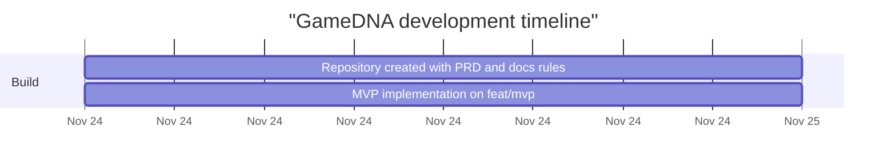

# 🧬 GameDNA originality and provenance record

This record supports the clean-slate policy in PRD section 1.1 and the release gate in PRD section 14.0. The PRD names this file `docs/originality.md`; `docs/rules.md` section 11 asks for uppercase names for new standard documents, so it is `docs/ORIGINALITY.md`.

Reading key for this document:

| Symbol | Meaning |
|---|---|
| 🧾 🗓️ ✍️ ☑️ | Section icons, defined in `docs/rules.md` section 2 |
| Gantt chart | Dates and durations |

## 🧾 1. Provenance record

| Item | Record |
|---|---|
| Repository | `bala2006/game-dna`, created for this entry |
| First commit | `c012763`, 24 November 2026, 17:25 IST: PRD, docs rules and editor settings only |
| MVP implementation | Branch `feat/mvp`, written on 24 November 2026 in a Kiro session directed by the entrant |
| Eligible window | 30 October 2026, 9:00 AM PDT to 4 December 2026, 2:00 PM PST |
| Scaffold generators | None. Every config file was written by hand. |
| Imported code | None. Third-party packages are used as pinned npm dependencies through public APIs (`docs/DEPENDENCY_INVENTORY.md`). |
| Assets | All art and sound are generated by `packages/assets` from recorded seeds. Manifests: `apps/gravity-shift/.gamedna/assets-manifest.json`, `apps/neon-survivor/.gamedna/assets-manifest.json`, `packages/assets/samples/manifest.json`. |
| Fonts | System fonts only. No font files are distributed. |
| Kiro evidence | Root `.kiro/` (spec, steering, hooks, workspace MCP config) and `apps/*/.kiro/` (game specs, steering, hooks) |

First-party components written for GameDNA: `packages/core`, `packages/assets`, `packages/starter`, `packages/phaser-adapter`, `packages/mcp`, `packages/workbench`, `power/plugin.json`, `power/mcp.json`, the six skills in `power/skills/`, `apps/gravity-shift`, `apps/neon-survivor`, `scripts/`, `tests/`, `.github/` and the documents in `docs/` other than the PRD and rules, which predate this branch.

`power/server/` is generated by `npm run build:power` from first-party source plus the packages listed in `docs/THIRD_PARTY_NOTICES.md`.

## 🗓️ 2. Development timeline

| Date | Milestone | Evidence |
|---|---|---|
| 24 Nov 2026 | Repository created with PRD and docs rules | Commit `c012763` |
| 24 Nov 2026 | MVP: Kiro spec, core, assets, starter, adapter, MCP server, workbench, Power, both games, tests, docs | Branch `feat/mvp` and its pull request |

The Gantt chart below shows the milestones from the table above.

Add a row for each later milestone when it is committed. Commit dates alone do not prove originality; the history and the code must be reviewed together.

## ✍️ 3. Authorship statement

The MVP code, skills, scenarios, assets and documents on `feat/mvp` were generated by Kiro during the competition window at the entrant's direction, using the entrant's Kiro session. No other AI provider or coding agent was used. Research papers and official documentation listed in PRD section 17 informed the design and are cited in the skills; no code, text or art was copied from them.

## ☑️ 4. Audit status

> [!IMPORTANT]
> The entrant has not yet completed the originality review. Do not state that the zero-reuse policy is satisfied until every row below reads "Done".

| Gate | Status | Notes |
|---|---|---|
| Fresh repository history | Done | One commit before this branch, containing only planning documents |
| No scaffold generators or templates | Done | Config written by hand; no `create-*` tool was run |
| Dependency and license inventory | Done | `docs/DEPENDENCY_INVENTORY.md`, `docs/THIRD_PARTY_NOTICES.md` |
| Asset provenance manifests | Done | Every generated file has generator, version, seed, hash and license |
| Production builds exclude the dev bridge | Done | `scripts/check-prod-bridge.mjs` runs in each game's `npm run build` |
| Entrant review of first-party code and history | Pending | Entrant to read the diff and attest |
| Organizer rules reconfirmed before submission | Pending | Recheck the official rules page before 4 December 2026 |
