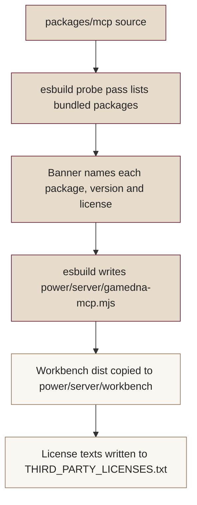

# 🧬 GameDNA third-party notices

GameDNA's own code is MIT licensed (see `LICENSE`). This file lists third-party code that GameDNA redistributes and the notices it requires.

Reading key for this document:

| Symbol | Meaning |
|---|---|
| ⚖️ 🗜️ | Section icons, defined in `docs/rules.md` section 2 |
| Flowchart | Steps and decisions, read top to bottom |

## ⚖️ 1. License notices

| Package | License | Copyright holder | Redistributed in |
|---|---|---|---|
| Phaser 3.90.0 | MIT | Richard Davey, Phaser Studio Inc. | `apps/*/dist` game builds |
| React, React DOM 19.3.1 and scheduler | MIT | Meta Platforms, Inc. and affiliates | `power/server/workbench` |
| Model Context Protocol TypeScript SDK 1.32.2 | MIT | Anthropic, PBC and contributors | `power/server/gamedna-mcp.mjs` |
| Zod 4.6.7 | MIT | Colin McDonnell | `power/server/gamedna-mcp.mjs` |
| zod-to-json-schema 3.25.2 | ISC | Stefan Terdell | `power/server/gamedna-mcp.mjs` |
| Ajv 8.20.0 and ajv-formats 3.0.1 | MIT | Evgeny Poberezkin | `power/server/gamedna-mcp.mjs` |
| fast-deep-equal 3.1.3, json-schema-traverse 1.0.0 | MIT | Evgeny Poberezkin | `power/server/gamedna-mcp.mjs` |
| fast-uri 3.1.9 | BSD-3-Clause | Gary Court; the Fastify team | `power/server/gamedna-mcp.mjs` |

The MIT, ISC and BSD-3-Clause licenses require the copyright notice and license text to travel with redistributed copies. `npm run build:power` writes the full license text of every package redistributed under `power/server/` to `power/server/THIRD_PARTY_LICENSES.txt`. Each game build writes the Phaser license text to `dist/THIRD_PARTY_LICENSES.txt` (`scripts/copy-licenses.mjs`).

Playwright (Apache-2.0) is not redistributed. The MCP server loads it from the user's game project at runtime.

## 🗜️ 2. Bundled code

The flowchart below shows how the generated Power bundle is produced, using the steps in `scripts/build-power.mjs`.

The bundle exists so the Power installs from GitHub without an `npm install` step. It contains only the packages in section 1, unmodified, plus GameDNA code. Rebuild it with `npm run build:power`.
