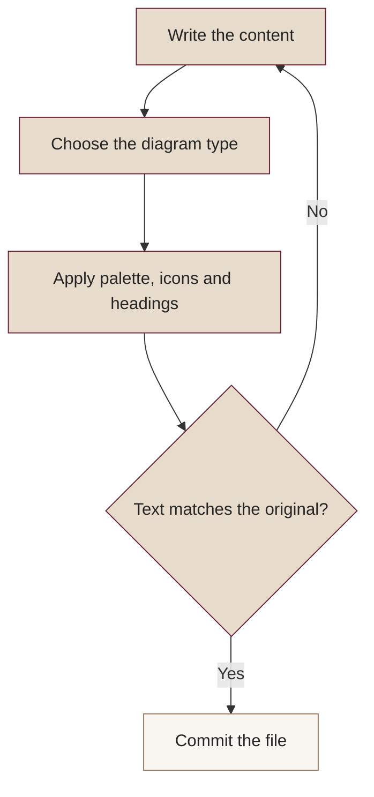

# <span style="color:#B84D73">🧬 Document formatting rules</span>

These rules apply to every Markdown file in `docs/`, including the PRD. They change how a document looks and how its content is organized. They do not change what the document says.

## <span style="color:#B84D73">1. Color palette</span>

The palette comes from the design system reference: burgundy, ivory, beige and charcoal.

| Token | Hex | Use |
|---|---|---|
| Burgundy text | `#B84D73` | H1 and H2 headings, P0 labels |
| Tan text | `#9A7B5F` | H3 headings |
| Amber text | `#B26B00` | P1 labels |
| Slate text | `#6B7A86` | P2 labels |
| Burgundy brand | `#6B2038` | Diagram fills for the AI assistant |
| Ivory | `#FAF7F2` | Diagram fills and light text on burgundy |
| Beige | `#E7DCCB` | Diagram fills for project components |
| Charcoal | `#242424` | Diagram text |

The brand burgundy `#6B2038` is too dark to read on a dark editor theme. Text therefore uses the lighter shades above. Those shades stay readable on light and dark themes.

## <span style="color:#B84D73">2. Icons</span>

Every H2 section starts with one icon from the table below. Put the icon after the opening color tag and a space, as shown in the example.

| Heading | Icon | Topic |
|---|---|---|
| H1 title | 🧬 | Document title |
| 1. Executive summary | 💡 | The idea in one page |
| 2. Problem definition and research | 🔎 | Evidence and background |
| 3. Product strategy | 🧭 | Direction and goals |
| 4. Product experience | 🎮 | What the user sees and does |
| 5. Functional requirements | ✅ | Requirements to build |
| 6. GameDNA design record | 🧬 | Stored decisions |
| 7. Architecture | 🧱 | Components and boundaries |
| 8. MCP interface contract | 🔌 | Tool inputs and outputs |
| 9. Expert skill specification | 📚 | Skills and their content |
| 10. Metrics and acceptance criteria | 📏 | How success is measured |
| 11. Two hackathon applications | 🧩 | The demo applications |
| 12. Security, privacy and reliability | 🔒 | Safety rules |
| 13. Delivery plan | 📅 | Schedule |
| 14. Kiroween 2026 submission strategy | 🎃 | Submission rules and proof |
| 15. Risks and mitigation | 🚨 | What could go wrong |
| 16. Post-hackathon roadmap | 🚀 | Later versions |
| 17. Research references | 🔗 | Sources |

```markdown
## <span style="color:#B84D73">💡 1. Executive summary</span>
```

When a new section needs an icon, add a row to this table first. Keep the icon meaning stable across documents.

A document that uses icons or charts opens with a short reading key. The key is a table that explains each symbol. The PRD shows the pattern.

## <span style="color:#B84D73">3. Headings</span>

- Use one H1 per file. It holds the document title and uses burgundy text.
- Use H2 for numbered sections such as `## 1. Executive summary`. Use burgundy text and the icon from section 2.
- Use H3 for numbered subsections such as `### 1.1 Mandatory policy`. Use tan text. H3 headings take no icon.

```markdown
## <span style="color:#B84D73">1. Executive summary</span>
### <span style="color:#9A7B5F">1.1 Mandatory policy</span>
```

Keep the number and the title text the same when you restyle a heading.

## <span style="color:#B84D73">4. Priority labels</span>

Priority values in table cells use an icon, then bold colored text with the label kept inside the tag:

```markdown
| 🔴 <span style="color:#B84D73"><b>P0</b></span> |
| 🟠 <span style="color:#B26B00"><b>P1</b></span> |
| 🔵 <span style="color:#6B7A86"><b>P2</b></span> |
```

P0 is burgundy and red, P1 is amber and orange, and P2 is slate and blue. Prose that explains the scale keeps plain text.

## <span style="color:#B84D73">5. Callouts</span>

Use GitHub alert syntax for a paragraph that the reader must not miss. Each line of the callout starts with `> `.

| Type | Use it for |
|---|---|
| `[!IMPORTANT]` | A rule that every contributor must follow |
| `[!TIP]` | Advice that makes the work easier |
| `[!WARNING]` | A condition that blocks or stops the work |
| `[!NOTE]` | Context or the summary of intent |
| `[!CAUTION]` | A claim that readers could easily misread |

```markdown
> [!IMPORTANT]
> Start from a new, empty repository.
```

Use at most one callout per section. A section with several callouts has too many rules to scan.

## <span style="color:#B84D73">6. Tables</span>

- Use standard pipe tables. Leave the header row unstyled.
- Apply the priority format from section 4 to priority cells.
- Wrap code identifiers, such as tool names and error codes, in backticks.
- Use a table, not a diagram, to compare options side by side.

## <span style="color:#B84D73">7. Diagrams, flowcharts and charts</span>

Every document shows its structure visually. Add a diagram under the heading that explains the content. Use the diagram type that fits the content:

| Content in the section | Diagram type | Mermaid start line |
|---|---|---|
| Ordered steps with decisions | Flowchart | `flowchart TD` |
| Components and how they connect | Architecture flowchart | `flowchart TD` |
| Status changes over time | State diagram | `stateDiagram-v2` |
| Messages between actors, in order | Sequence diagram | `sequenceDiagram` |
| Share of items in each category | Pie chart | `pie showData` |
| Counts per area | Bar chart | `xychart-beta` |
| Dates and durations | Gantt chart | `gantt` |

Follow these rules for every diagram and chart:

- Write one sentence above each diagram that says what it shows.
- Keep each diagram to about 15 nodes. Split a larger diagram into two.
- Use the same node labels that the text uses.
- Quote every label that contains punctuation, such as parentheses, commas, colons, slashes or periods. For example: `A["Review docs/originality.md"]`.
- Every step, state and message comes from the text of the section. If a diagram adds a transition the text does not state, say in the lead-in that the transition is inferred.
- Name sequence participants with `participant ID as Name`.
- Every number in a chart comes from a table or a list in the same document. Name that source in the lead-in. Recount the numbers when the source changes.
- Flowcharts and state diagrams use the three classes below. Sequence, pie, bar and Gantt charts do not use these classes, so leave them with the default colors.

Copy these class definitions exactly:

```text
classDef kiro fill:#6B2038,stroke:#6B2038,color:#FAF7F2
classDef gd fill:#E7DCCB,stroke:#6B2038,color:#242424
classDef game fill:#FAF7F2,stroke:#9A7B5F,color:#242424
```

- Assign `kiro` to the AI assistant and its specs, steering and hooks.
- Assign `gd` to components the project builds, and to process steps.
- Assign `game` to the developer, the game under test and output artifacts.

Place the class lines after the last node definition. Do not add other colors to a diagram.

This example shows the authoring flow for a document:



## <span style="color:#B84D73">8. Preview</span>

`docs/markdown.css` styles the editor preview for every Markdown file in the workspace. The workspace file `.vscode/settings.json` sets `markdown.styles` to that stylesheet. The stylesheet changes headings, table borders and callout bars. It does not replace the inline color tags in sections 3 and 4.

VS Code 1.121 and later render Mermaid diagrams in the built-in preview. The Markdown Preview Mermaid Support extension was merged into VS Code and is deprecated, so do not install it. On an older editor, diagrams show as plain code. Open the preview and confirm that each diagram draws before you commit.

## <span style="color:#B84D73">9. Color and icons are never the only signal</span>

Colored text is an inline `<span style="color">` tag. Previewers that allow inline styles show the color. GitHub removes inline styles, so the text appears in the default color there. Every colored label must still read correctly without its color. P0, P1 and P2 read correctly on their own, and the icons add a second signal.

## <span style="color:#B84D73">10. Formatting never changes the words</span>

Restyle a document without rewording it. Before you commit a restyled file, remove the `<span>` tags, the `<b>` tags, the icons, the callout marker lines and the added diagram, chart and reading-key blocks. The remaining lines must match the text before restyling, in the same order. A file that fails this check contains a content change, and that change needs its own review.

Charts, lead-ins and reading keys are added lines. They do not count as content changes, but each one must match its source table or list (section 7).

## <span style="color:#B84D73">11. Placement and names</span>

- Keep every project document in `docs/`.
- Keep the existing file name of a document. The PRD is `docs/GameDNA_PRD_v1.1_Kiroween.md`.
- Name a new standard document in uppercase with underscores, such as `DESIGN_SYSTEM.md` or `TESTING.md`.

## <span style="color:#B84D73">12. Checklist before you commit</span>

- [ ] One H1, burgundy, with the 🧬 icon.
- [ ] Every H2 is burgundy and starts with its icon from section 2. Every H3 is tan.
- [ ] Every priority cell uses the section 4 format with its icon.
- [ ] Every callout uses one of the five types from section 5.
- [ ] Every section that describes steps, structure, states, messages or schedules has a diagram (section 7).
- [ ] Every flowchart and state diagram uses the section 7 classes.
- [ ] Every chart number matches its source table or list.
- [ ] The document has a reading key when it uses icons or charts.
- [ ] Each diagram draws in the preview (section 8).
- [ ] The text matches the version before restyling (section 10).
